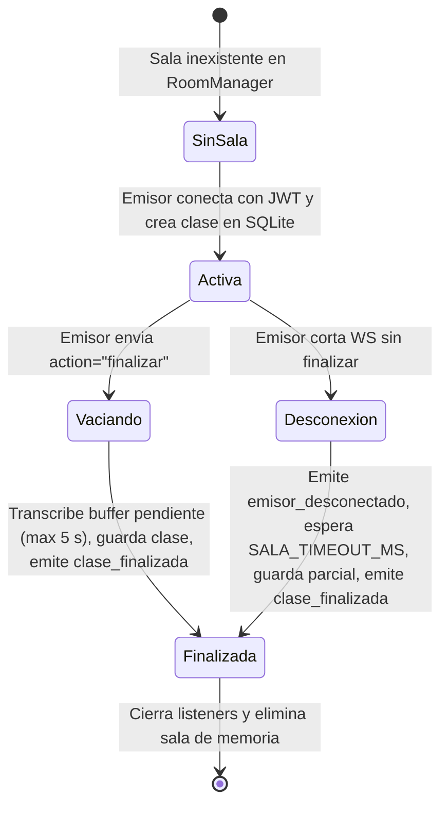

# Documentación Técnica y Guía de Defensa — Puente LSCh

**Estado del repositorio documentado:** hasta `SPEC-006` (implementada y verificada).  
**Propósito:** reunir en un único documento todo lo que está efectivamente construido en código, cómo funciona internamente cada pieza, qué decisiones técnicas lo respaldan, qué limitaciones existen hoy y cómo defender el proyecto frente a preguntas técnicas, metodológicas o normativas de la comisión evaluadora.

---

## 1. Visión general y alcance real hoy

**Puente LSCh** es una aplicación web progresiva (PWA) cliente-servidor orientada a apoyar la inclusión de estudiantes sordos en aulas universitarias de la Universidad del Bío-Bío. Durante una clase presencial, captura la voz del docente, la transcribe en tiempo real como subtítulos continuos, detecta conceptos clave de un glosario del curso mediante procesamiento de lenguaje natural (`spaCy`) y despliega los clips de Lengua de Señas Chilena (LSCh) asociados, dejando además un historial consultable con lectura de apunte y reproducción en diferido (*replay*).

### Qué está implementado vs qué sigue pendiente

| Bloque | Estado | Qué cubre | Referencia |
|---|---|---|---|
| **Fundación y eco WebSocket** | Implementado | Estructura `backend/`, `frontend/`, `ml/`, Docker Compose, `/health` | `SPEC-001` |
| **Núcleo backend modular** | Implementado | FastAPI, SQLite, `spaCy`, `RoomManager`, endpoints iniciales | `SPEC-002` |
| **PWA y flujo en vivo** | Implementado | React + Vite PWA, captura de audio, subtítulos y reproductor | `SPEC-003` |
| **Perfil estudiante, salas fan-out e historial** | Implementado | Login RUT+JWT, salas `[COD_RAMO]-[SECCION]`, historial y replay | `SPEC-004` |
| **Auditoría UX y cierre de salas** | Implementado | Auth Bearer en REST, reconexión WS con backoff, manejo de errores y cierre real | `SPEC-005` |
| **Transcripción real (PCM + faster-whisper)** | Implementado | `AudioWorklet` 16 kHz s16le, `Segmentador` RMS, `FasterWhisperProvider` local, retiro de Google | `SPEC-006` |
| **Glosario piloto, clips de ensayo y matching v2** | Pendiente (Borrador) | Curso único `INF-221`, clips MP4 generados, doble clave + bloqueos, cola acotada | `SPEC-007` |
| **Mediciones cuantitativas de la PoC** | Pendiente (Borrador) | WER, latencia de servidor, precisión/recuperación de mapeo, carga 20 receptores | `SPEC-008` |
| **Acceso por inscripción, pausa compartida y seguridad** | Pendiente (Borrador) | Permiso `puede_capturar`, clips protegidos, pausa en servidor, `scrypt`, CORS/JWT | `SPEC-009` |
| **Co-diseño PIESDI y banco real (80–150 términos)** | Fuera de software (`OE1`) | Acuerdo con docente, validación con intérpretes y grabación real | Propuesta / Informe |

### Decisión estructural clave: el paradigma centrado en el estudiante
Originalmente (`SPEC-001` a `SPEC-003`) existían dos vistas separadas ("Soy profesor" y "Soy alumno"). A partir de `SPEC-004`, la plataforma se reestructuró bajo un **perfil único centrado en el estudiante**:
* **Por qué:** el docente no necesita operar la aplicación ni iniciar sesión durante la cátedra. El estudiante con permiso/rol de captura conecta un micrófono (idealmente lavalier inalámbrico) a su dispositivo y entrega el transmisor al docente.
* **Emisor único + Fan-out (1 → N):** el primer usuario que inicia la transmisión en una sala actúa como **emisor** (`rol=emitter`), capturando y enviando audio. Si hay otros estudiantes de la misma clase conectados, entran como **oyentes** (`rol=listener`) y reciben exactamente la misma transcripción y señas sin duplicar la inferencia ASR.

---

## 2. Arquitectura y flujo de datos en tiempo real

### 2.1 Diagrama de componentes y flujo en vivo

```mermaid
flowchart LR
    Mic["Micrófono (dispositivo emisor)"] --> AW["AudioWorklet (pcm-worklet.js, 16 kHz s16le, 100 ms)"]
    AW -->|"Binario 3200 B cada 100 ms"| WS["WebSocket /ws/sala/{room_id}"]
    WS --> Q["asyncio.Queue (backend/app/main.py)"]
    Q --> ASR["FasterWhisperProvider / StubAsrProvider"]
    ASR --> Seg["Segmentador RMS (subtramas 30 ms, pre-roll 240 ms)"]
    Seg -->|"Ventanas PCM float32"| WM["WhisperModel (CTranslate2, CUDA/CPU, Lock único)"]
    WM -->|"final: false (cada 1 s)"| Br["RoomManager.broadcast"]
    WM -->|"final: true (silencio 600 ms / 15 s / cierre)"| NLP["spaCy (es_core_news_md, n-gramas)"]
    NLP -->|"Senas detectadas"| DB[("SQLite WAL (evento_clase)")]
    NLP --> Br
    Br -->|"JSON segmento"| Em["Emisor (SalaView.jsx)"]
    Br -->|"JSON segmento"| Oy["Oyentes (SalaView.jsx)"]
    Em --> UI["Subtítulos por segment_id + SenaPlayer"]
    Oy --> UI
```



### 2.2 Ciclo de vida de una sesión (`ws_sala`)



### 2.3 Separación de provisionales y finales (regla `RN10`)
1. Mientras el docente habla sin pausas mayores a `ASR_SILENCIO_MS` (600 ms), el `Segmentador` emite ventanas provisionales cada `ASR_PARCIAL_MS` (1000 ms) con el mismo `segmento_id`.
2. El servidor difunde las provisionales con `"final": false` y `"senas": []` — **no ejecuta matching NLP ni escribe en `evento_clase`**. Así se evita disparar clips erróneos si Whisper corrige una palabra al avanzar la frase, y no se ensucia el historial.
3. Cuando hay 600 ms de silencio tras voz, el segmento alcanza 15 s (`ASR_MAX_SEGMENTO_MS`), dejan de llegar tramas por 600 ms o el emisor finaliza la clase, se emite la ventana final (`estable=True`) con el **mismo `segmento_id`**.
4. Solo entonces el backend ejecuta `buscar_terminos()` sobre el texto consolidado, inserta **una sola fila** en `evento_clase`, y difunde `"final": true` con la lista `senas`.
5. En el frontend (`SalaView.jsx`), los subtítulos se indexan y reemplazan por `segment_id`, evitando duplicados al consolidar el texto.

---

## 3. Decisiones técnicas y su justificación

Esta sección responde a preguntas del tipo *"¿por qué usaron tecnología X en vez de Y?"*.

| Decisión | Alternativa descartada / del informe | Justificación en el prototipo |
|---|---|---|
| **Python 3.11/3.14 + FastAPI** | Node.js + Express | El ecosistema de audio, ASR (`faster-whisper`), NLP (`spaCy`) y evaluación (`pytest`, futuro `jiwer`) vive nativo en Python; FastAPI aporta WebSockets ASGI asíncronos y validación Pydantic sin capa extra. |
| **PWA React + Vite (JS)** | App móvil nativa o TypeScript | Un único código corre en computador, tablet y celular sin pasar por tiendas. Se usó JavaScript (divergiendo de TypeScript del informe) para priorizar velocidad de iteración en la PoC. El routing por hash (`#/...`) evita configurar reescrituras SPA complejas durante desarrollo. |
| **Captura con `AudioWorklet` (PCM s16le 16 kHz)** | `MediaRecorder` (WebM/Opus) | `MediaRecorder` (usado hasta `SPEC-005`) solo incluye cabecera WebM en el primer fragmento: los trozos siguientes no son decodificables de forma aislada y una reconexión rompe el stream. PCM 16 kHz mono a 16 bits es el formato nativo de Whisper (32 kB/s exactos) y permite segmentación determinista por energía. |
| **Remuestreo lineal en el worklet** | Asumir `AudioContext` a 16 kHz | Navegadores móviles, Firefox o controladores de audio de Windows suelen forzar 44.1 kHz o 48 kHz aunque se solicite 16 kHz. El procesador `pcm-worklet.js` detecta `sampleRate` global y remuestrea en tiempo real con interpolación lineal sin pérdida de continuidad entre bloques de 128 muestras. |
| **`faster-whisper` local** | Google Cloud Speech-to-Text / Web Speech API | El adaptador anterior de Google (`google_streaming.py`) estaba incompleto, no tenía credenciales y requería enviar voz a un tercero (restringido por autorización y Leyes 19.628 / 21.719). Web Speech API solo opera en motores Chromium y depende de la nube de Google. `faster-whisper` corre offline sobre CTranslate2 (`float16` en GPU CUDA / `int8` en CPU), sin costo por minuto ni fuga de audio. |
| **`Segmentador` por RMS + `vad_filter`** | Enviar todo el audio crudo al modelo o usar Silero continuo | Whisper no es un modelo streaming puro sino de ventanas. Detectar energía RMS en subtramas de 30 ms con pre-roll de 240 ms permite ignorar silencio sin gastar GPU/CPU, controlar el ritmo de provisionales (`1000 ms`) y omitir provisionales si hay atraso (`> ASR_PARCIAL_MS`). Whisper además aplica su filtro de voz interno (`vad_filter=True`) y `condition_on_previous_text=False` para evitar alucinaciones repetitivas en silencios. |
| **`spaCy` (`es_core_news_md`) + n-gramas** | Matching exacto por substring o LLM generativo | El matching exacto falla ante flexiones ("hablando" vs "hablar"). `spaCy` provee tokenización, lematización y etiquetas POS en ~3 ms por frase y de forma determinista. Filtrar `DET`, `ADP`, `CCONJ`, `SCONJ` y puntuación permite que *"teorema del valor medio"* coincida con *"teorema valor medio"*. |
| **SQLite con modo WAL** | PostgreSQL | Para la PoC (1–4 cursos, decenas de términos y sesiones locales), SQLite con `WAL` y `foreign_keys=ON` elimina la gestión de otro servicio manteniendo integridad relacional y SQL estándar. |
| **`RoomManager` en memoria** | Redis Pub/Sub / Kafka | Con un único proceso Uvicorn, mantener salas y sets de WebSockets en memoria da latencia mínima (microsegundos) sin dependencias extra. Limitación asumida para Proyecto de Título: no escala horizontalmente a múltiples workers ni soporta recuperación por secuencia ante reconexiones. |
| **Nginx con HTTPS autofirmado + Cloudflare Tunnel** | HTTP plano | Las APIs web `getUserMedia`, `AudioWorklet` y la instalación como PWA **exigen contexto seguro** (`localhost` o HTTPS). Para probar desde celulares en red local se genera una CA propia y certificado con SAN para la IP local, además de soporte opcional para Cloudflare Tunnel (`wss://` automático). |

---

## 4. Arquitectura detallada del Backend (`backend/`)

### 4.1 Estructura de módulos

```text
backend/
├── app/
│   ├── main.py                      # App FastAPI, lifespan, CORS, estáticos, /api/cursos, /ws/sala, /ws/echo
│   ├── asr/
│   │   ├── base.py                  # ResultadoASR, StreamingASRProvider, AsrConfigError, get_asr_provider()
│   │   ├── segmentador.py           # Segmentador por energía RMS (30 ms) + Ventana
│   │   ├── whisper_local.py         # FasterWhisperProvider, caché singleton de WhisperModel y locks
│   │   └── stub.py                  # StubAsrProvider (10 frases fijas en bucle para desarrollo/tests)
│   ├── auth/
│   │   └── routes.py                # POST /api/auth/login, GET /api/auth/usuario/me
│   ├── core/
│   │   ├── auth.py                  # crear_token, verificar_token, obtener_rut, hash_password
│   │   ├── config.py                # Settings (pydantic-settings) desde variables de entorno / .env
│   │   ├── db.py                    # Conexión singleton SQLite WAL, init_schema(), migraciones
│   │   └── nlp.py                   # Singleton get_nlp() cargando spacy.load("es_core_news_md")
│   ├── evaluation/
│   │   └── logging.py               # Legado de SPEC-002 (tablas sesion/segmento), actualmente sin uso
│   ├── glossary/
│   │   ├── matching.py              # buscar_terminos(texto, glosario_por_lema, max_ngrama=3)
│   │   └── repository.py            # list_cursos, list_terminos, get_glosario_por_lema, inserts
│   ├── historial/
│   │   ├── repository.py            # CRUD de clase y evento_clase + usuario_participa()
│   │   └── routes.py                # GET /api/historial, GET /api/historial/{id}, GET /api/salas/{id}/estado
│   ├── salas/
│   │   └── manager.py               # RoomState y RoomManager (pub/sub en memoria, locks por loop)
│   └── signs_recognition/
│       └── __init__.py              # Placeholder vacío (módulo secundario alumno→profesor, fuera de PoC)
├── data/
│   ├── schema.sql                   # Definición de las 8 tablas SQLite
│   ├── seed_glosario.json           # Datos semilla actuales (4 cursos, 2 usuarios, 29 términos)
│   └── videos_senas/                # 12 MP4 locales de 28 bytes (placeholders en .gitignore)
├── scripts/
│   └── seed_glosario.py             # Poblamiento destructivo/idempotente desde seed_glosario.json
├── tests/                           # Suite pytest (46 pruebas totales)
├── Dockerfile                       # Imagen python:3.11-slim + libgomp1 + es_core_news_md + seed
└── requirements.txt                 # Dependencias Python fijadas
```

### 4.2 Flujo interno del módulo ASR (`app/asr/`)

1. **`base.py`:**
   * `ResultadoASR(segmento_id, texto, estable, inicio_ms, fin_ms)`: contrato único que devuelven tanto el stub como Whisper.
   * `get_asr_provider(provider=None)`: fábrica que lee `ASR_PROVIDER` (`"whisper"` o `"stub"`). Cualquier otro valor lanza `AsrConfigError` indicando las opciones válidas (`whisper | stub`).
2. **`segmentador.py`:**
   * Recibe tramas binarias `s16le` (`<i2` little-endian), valida longitud par y las normaliza a `float32` en `[-1, 1]`.
   * Procesa en subtramas fijas de **30 ms (480 muestras)** acumulando residuos entre tramas de 100 ms.
   * Calcula `rms = sqrt(mean(sub**2))` y compara contra `umbral_rms = 0.01`.
   * **Pre-roll (240 ms):** guarda hasta 8 subtramas silenciosas previas en un `deque`; al detectarse voz, las antepone al segmento para no cortar el ataque consonántico de la primera palabra.
   * **Disparo provisional:** cada `parcial_ms` (1000 ms) desde el inicio/último parcial mientras el segmento sigue abierto (`final=False`).
   * **Disparo final (`final=True`):** cuando se acumulan `silencio_ms` (600 ms) de silencio tras voz, cuando el segmento alcanza `max_segmento_ms` (15000 ms) o al invocar `cerrar()`.
3. **`whisper_local.py` (`FasterWhisperProvider`):**
   * **Carga única:** `_cargar_whisper_model()` mantiene un diccionario `_MODELO_CACHE` protegido por `_MODELO_LOCK`. En `main.py`, el `lifespan` invoca `get_asr_provider()` al arrancar si `ASR_PROVIDER=whisper`, fallando rápido con `AsrConfigError` en español si falta el paquete o falla el modelo.
   * **Resolución de dispositivo (`WHISPER_DEVICE`):**
     * `auto`: consulta `ctranslate2.get_cuda_device_count()`. Si hay GPU, intenta `device="cuda"` con `float16`; si falla o no hay CUDA, registra `logger.warning` y cae a `device="cpu"` con `int8`.
     * `cuda` o `cpu` explícitos: fuerzan el dispositivo correspondiente (lanzando `AsrConfigError` si falla).
   * **Ejecución no bloqueante y exclusión mutua:** cada ventana se ejecuta en un hilo separado vía `asyncio.to_thread`, serializada con un `asyncio.Lock` por event loop (`_ASYNC_LOCKS`) y `_MODELO_LOCK`, impidiendo que dos salas concurrentes compitan sobre el mismo `WhisperModel`.
   * **Manejo de falta de tramas y atraso:** una tarea `_pump` vuelca `audio_iter` a una `asyncio.Queue` llevando la cuenta exacta de `queued_bytes`:
     * Si no llegan tramas durante `ASR_SILENCIO_MS`, `asyncio.wait_for` vence y ejecuta `segmentador.cerrar()`, consolidando la frase abierta.
     * Al drenar la cola tras una inferencia, si había más de `ASR_PARCIAL_MS` de audio pendiente, `_filtrar_ventanas` conserva **todas** las ventanas finales pero omite las provisionales hasta ponerse al día.
   * **Parámetros de inferencia:** `language` normalizado (`"es-CL"` → `"es"`), `vad_filter=True`, `condition_on_previous_text=False` e `initial_prompt` armado con la lista deduplicada de `texto_visible` del glosario si `ASR_PROMPT_GLOSARIO=true`.
4. **`stub.py` (`StubAsrProvider`):**
   * Vigila `audio_iter` en segundo plano para detenerse inmediatamente cuando la sala finaliza (`None` en la cola), y mientras tanto emite ciclicamente las 10 frases de `FRASES` cada `STUB_INTERVAL_MS` con `segmento_id` secuencial y tiempos simulados.

### 4.3 Motor de coincidencia lingüística (`app/glossary/matching.py`)
`buscar_terminos(texto, glosario_por_lema, max_ngrama=3)`:
1. Ejecuta el modelo `es_core_news_md` de `spaCy` sobre el texto final.
2. Filtra tokens con `pos_` en `{"DET", "ADP", "CCONJ", "SCONJ"}` (artículos, preposiciones, conjunciones) y puntuación (`is_punct`), extrayendo `token.lemma_.lower()`.
3. Recorre la secuencia de lemas de izquierda a derecha probando ventanas descendentes de tamaño `n = min(max_ngrama, len - i)` hasta `1` (*greedy longest-match*).
4. Si `" ".join(lemas[i : i + n])` existe como clave en `glosario_por_lema`, agrega el diccionario del término encontrado y avanza `i += n`; si no, avanza `i += 1`.

### 4.4 Gestión de salas, vaciado y cierre (`app/main.py` y `app/salas/manager.py`)
* `RoomManager` administra `_salas: dict[str, RoomState]` con locks indexados por event loop (`WeakKeyDictionary`) para soportar múltiples loops de `pytest` y concurrencia asíncrona en producción.
* Al conectarse el emisor (`rol=emitter`):
  1. Valida JWT, formato `COD_RAMO-SECCION`, existencia del curso y que no exista ya una sala activa para ese `room_id`.
  2. Instancia el proveedor ASR antes de crear la sala (si falla la configuración, cierra con error sin dejar sala huérfana).
  3. Crea el `RoomState` con el glosario del curso e inserta un registro inicial en `clase`.
  4. Lanza dos tareas concurrentes: `_receiver` y `_transcribir`.
* **Validación de tramas binarias en `_receiver`:** descarta toda trama con longitud impar o `> ASR_MAX_TRAMA_BYTES` (64000 bytes), emitiendo un único `logger.warning` por sesión.
* **Finalización explícita vs desconexión abrupta:**
  * Si recibe `{"action": "finalizar", "titulo": ...}`: encola `None` en `audio_queue`, `_audio_gen` termina y espera a `_transcribir` hasta `ASR_FLUSH_TIMEOUT_MS` (5000 ms) para procesar y persistir el último tramo hablado antes de llamar `finalizar_clase` y emitir `clase_finalizada`.
  * Si el emisor corta la conexión sin finalizar: marca `stop_event`, difunde `emisor_desconectado`, espera `SALA_TIMEOUT_MS` (30000 ms en prod, 100 ms en tests), persiste la clase con el timeline parcial obtenido hasta ese instante, difunde `clase_finalizada` y cierra todos los WebSockets oyentes.
  * El bloque `try ... finally` garantiza ejecutar `RoomManager.eliminar(room_id)` incluso si la tarea es cancelada.

### 4.5 Variables de configuración (`app/core/config.py`)

| Variable | Por defecto | Descripción |
|---|---|---|
| `PORT` | `8000` | Puerto del servidor FastAPI |
| `ASR_PROVIDER` | `"stub"` | Proveedor activo: `"stub"` o `"whisper"` |
| `WHISPER_MODEL` | `"small"` | Modelo de `faster-whisper` (`tiny`, `base`, `small`, etc.) |
| `WHISPER_DEVICE` | `"auto"` | `"auto"` (intenta CUDA y cae a CPU), `"cuda"` o `"cpu"` |
| `WHISPER_COMPUTE_TYPE` | `"auto"` | `"auto"` (`float16` en CUDA, `int8` en CPU) o tipo explícito |
| `ASR_SILENCIO_MS` | `600` | Silencio o ausencia de tramas (ms) que cierra un segmento |
| `ASR_MAX_SEGMENTO_MS` | `15000` | Duración máxima de un segmento continuo (ms) |
| `ASR_PARCIAL_MS` | `1000` | Cadencia mínima de resultados provisionales (ms) |
| `ASR_FLUSH_TIMEOUT_MS` | `5000` | Espera máxima para vaciar el búfer al finalizar la clase (ms) |
| `ASR_MAX_TRAMA_BYTES` | `64000` | Límite de bytes aceptados por mensaje binario PCM |
| `ASR_PROMPT_GLOSARIO` | `True` | Inyectar `texto_visible` del glosario como `initial_prompt` |
| `SPACY_MODEL` | `"es_core_news_md"` | Modelo de `spaCy` cargado por `get_nlp()` |
| `DB_PATH` | `backend/data/glosario.db` | Ruta del archivo SQLite |
| `STUB_INTERVAL_MS` | `1500` | Intervalo entre frases en modo `stub` |
| `JWT_SECRET` | `"cambiar-en-produccion"` | Secreto HMAC-SHA256 para JWT |
| `SALA_TIMEOUT_MS` | `30000` | Gracia tras desconexión abrupta del emisor antes de cerrar |
| `AUTH_PROVIDER` | `"local"` | Reservado para futura autenticación institucional |

---

## 5. Modelo de datos (`backend/data/schema.sql`) y estado actual del Seed

El esquema SQLite habilita `PRAGMA journal_mode=WAL` y `PRAGMA foreign_keys=ON`. Contiene 8 tablas:

1. **`curso`:** `(id PK, cod_ramo, nombre)`. Ej.: `1, "INF-221", "Estructuras de Datos"`.
2. **`termino`:** `(id PK, curso_id FK, lema, texto_visible, video_url, n_palabras)`. Almacena el vocabulario técnico y la ruta del clip (`/data/videos_senas/...`).
3. **`usuario`:** `(rut PK, password_hash, nombre, apellido)`.
4. **`inscripcion`:** `(rut FK, curso_id FK, seccion, PK(rut, curso_id, seccion))`.
5. **`clase`:** `(id PK, room_id, curso_id FK, seccion, rut_emisor FK, fecha_inicio, fecha_fin, duracion_ms, titulo)`. Registra cada sesión de clase.
6. **`evento_clase`:** `(id PK, clase_id FK, timestamp_ms, texto, estable, senas_json)`. Almacena los segmentos consolidados y las señas asociadas en formato JSON.
7. **`sesion` y `segmento`:** tablas heredadas de `SPEC-002` (usadas solo por `evaluation/logging.py` y un test de FK en `test_schema.py`; `SPEC-009` contempla retirarlas).

### Datos sembrados actualmente (`backend/data/seed_glosario.json`)
* **4 cursos:** `INF-221` (Estructuras de Datos), `MAT-101` (Álgebra Lineal), `FIS-110` (Física General), `HUM-105` (Ética Profesional).
* **2 usuarios de prueba (password `test123`, RUT con dígito verificador válido):**
  * `12345678-5` — Juan Pérez (inscrito en los 4 cursos).
  * `9876543-3` — María González (inscrita en los 4 cursos).
* **29 términos de prueba** y **12 archivos `.mp4` locales de 28 bytes** en `backend/data/videos_senas/` (que funcionan únicamente como placeholders técnicos y están ignorados en Git; `SPEC-007` los reemplazará por clips de ensayo generados con `ffmpeg` y vocabulario coherente).

---

## 6. Arquitectura del Frontend PWA (`frontend/`)

### 6.1 Estructura de módulos

```text
frontend/
├── public/icon.svg                    # Ícono SVG de la PWA
├── src/
│   ├── main.jsx                       # Punto de entrada React 18
│   ├── App.jsx                        # Router manual por window.location.hash
│   ├── App.css                        # Tema oscuro completo y diseño responsive
│   ├── api/
│   │   └── cliente.js                 # Cliente fetch con Bearer, normalización RUT, manejo 401
│   ├── audio/
│   │   ├── pcm-worklet.js             # AudioWorkletProcessor (resampling a 16 kHz, Int16 LE, RMS)
│   │   └── capturaPcm.js              # Ciclo de captura: iniciar, pausar, reanudar, detener
│   ├── hooks/
│   │   ├── useAuth.js                 # Estado de sesión en localStorage y evento puente-auth-expired
│   │   └── useWebSocket.js            # Reconexión con backoff exponencial [3, 6, 12, 24] s (máx 5)
│   ├── components/
│   │   ├── Header.jsx                 # Navbar con logo, tabs Inicio/Historial y avatar
│   │   ├── EstadoConexion.jsx         # Indicador visual conectado/reconectando/desconectado/fallo
│   │   ├── Feedback.jsx               # Banner visual de error/warning/info
│   │   ├── FinalizarModal.jsx         # Modal para asignar título opcional al cerrar clase
│   │   └── SenaPlayer.jsx             # Reproductor <video> muted/autoPlay/loop con fallback onError
│   └── views/
│       ├── LoginView.jsx              # Formulario RUT + contraseña + botón Instalar PWA
│       ├── DashboardView.jsx          # Clase actual destacada + grid de asignaturas + estado en vivo
│       ├── SalaView.jsx               # Vista en vivo (emisor PCM / oyente + subtítulos + señas)
│       ├── HistorialView.jsx          # Buscador, filtros asignatura/mes y cards por mes
│       └── ClaseDetailView.jsx        # Modos Apunte y Replay (1x/1.5x/2x + barra de progreso)
├── vite.config.js                     # Configuración Vite 5 + VitePWA (autoUpdate, manifest, sw.js)
├── nginx.conf                         # Reverse proxy HTTPS/SSL y proxy WS/API/data
├── Dockerfile                         # Build Node 20 + pnpm → nginx:alpine con openssl
└── docker-entrypoint.sh               # Sustituye BACKEND_UPSTREAM y genera CA/cert autofirmados
```

### 6.2 Captura PCM en el navegador (`src/audio/`)
1. **`capturaPcm.js` (`iniciar({ onTrama, onNivel })`):**
   * Solicita micrófono con `getUserMedia({ audio: { channelCount: 1, echoCancellation: true, noiseSuppression: true, autoGainControl: true } })`.
   * Crea `AudioContext` intentando `sampleRate: 16000` (con fallback a la frecuencia nativa del dispositivo si el navegador lo rechaza).
   * Carga `pcm-worklet.js` vía `new URL('./pcm-worklet.js', import.meta.url)` (que Vite empaqueta inline en producción para operar incluso en PWA).
   * Conecta `MediaStreamSource → AudioWorkletNode (1 canal explícito) → GainNode (ganancia 0) → AudioContext.destination` (necesario en Chromium para asegurar la ejecución continua del grafo sin acoplamiento acústico por parlantes).
   * Expone `pausar()` (ignora tramas sin destruir el stream), `reanudar()` (resetea acumuladores del worklet para no enviar audio antiguo) y `detener()` (desconecta nodos, detiene pistas del micrófono y cierra el `AudioContext`).
2. **`pcm-worklet.js` (`PcmProcessor`):**
   * Si `sampleRate === 16000`, acumula directamente muestras `Float32`; si es distinto (ej. 44100 o 48000 Hz), aplica interpolación lineal continua manteniendo cola de residuo (`_inTail`) y fase fraccionaria (`_inPos`) entre llamadas de `process()`.
   * Cada **1600 muestras (100 ms)** calcula la energía RMS y escribe un `ArrayBuffer` de **3200 bytes** en formato entero de 16 bits *little-endian* mediante `DataView.setInt16(..., true)`, transfiriéndolo por `port.postMessage({ buffer, rms }, [buffer])` sin copia de memoria.

### 6.3 Vistas y experiencia de usuario
* **Login (`LoginView.jsx`):** valida formato y dígito verificador chileno módulo 11 (`normalizarRut`) antes de llamar al servidor; gestiona el evento `beforeinstallprompt` (o guía manual de Chrome) para instalar la PWA.
* **Dashboard (`DashboardView.jsx`):** consulta las asignaturas inscritas y el estado en vivo de cada sala (`GET /api/salas/{roomId}/estado`), mostrando punto verde `"En vivo"` o `"Sin clase activa"`.
* **Sala en vivo (`SalaView.jsx`):**
  * **Emisor:** muestra medidor visual de nivel de señal (`.nivel-audio`), contador `mm:ss`, controles de Pausa/Reanudar y Finalizar y Guardar (`FinalizarModal`). Si el nivel RMS permanece bajo `UMBRAL_SILENCIO` (0.004) por 10 s mientras está activo, muestra el aviso `"No se detecta audio en el micrófono"` sin cortar la sesión y lo oculta al volver la señal. Al confirmar finalizar, detiene el micrófono, envía `{"action": "finalizar", "titulo"}` y espera `clase_finalizada` (hasta 6 s de respaldo) antes de cerrar el WebSocket para permitir el vaciado del último tramo hablado.
  * **Subtítulos:** actualiza o inserta entradas por `segment_id` (sin duplicar ni perder el lugar), resalta términos coincidentes con `<strong class="termino">` y persiste el tamaño de letra (`12–32 px`) en `localStorage`.
  * **Señas:** al llegar un segmento final con señas, las pasa a `SenaPlayer` y las muestra durante 4 s (nota: en `SPEC-007` se reemplazará el timeout de 4 s y el bucle por una cola secuencial completa).
* **Historial y Detalle (`HistorialView.jsx`, `ClaseDetailView.jsx`):** búsqueda en tiempo real por título/ramo/preview, filtros por asignatura y mes, vista **Apunte** (texto completo resaltado) y vista **Replay** (reproducción temporizada según `timestamp_ms`, velocidades `1x/1.5x/2x`, barra deslizante y video de seña sincronizado con el evento actual).

---

## 7. Contratos de API HTTP y WebSocket

### 7.1 Endpoints REST

| Método | Ruta | Autenticación | Descripción / Respuesta |
|---|---|---|---|
| `GET` | `/health` | Pública | `{"status": "ok"}` |
| `POST` | `/api/auth/login` | Pública | Recibe `{rut, password}`; valida hash y devuelve `{token, rut, nombre, apellido}` o `401` |
| `GET` | `/api/auth/usuario/me` | `Bearer` | Datos del usuario autenticado y sus inscripciones (`401` si falta/inválido) |
| `GET` | `/api/cursos` | `Bearer` | Lista cursos inscritos del RUT del token (`id, cod_ramo, nombre, seccion`) |
| `GET` | `/api/cursos/{curso_id}/glosario` | `Bearer` | Lista términos del curso desde SQLite |
| `GET` | `/api/salas/{room_id}/estado` | `Bearer` | Devuelve `{room_id, activa, rut_emisor}` |
| `GET` | `/api/historial` | `Bearer` | Clases de las secciones donde el usuario está inscrito, con `palabras` y `preview` |
| `GET` | `/api/historial/{clase_id}` | `Bearer` | Detalle de clase y sus eventos; exige ser emisor o estar inscrito (`403` si no, `404` si no existe) |
| `GET` | `/data/videos_senas/{archivo}` | Pública (estática) | Sirve archivos MP4 de señas |

### 7.2 Protocolo WebSocket (`/ws/sala/{room_id}?rol=emitter|listener&token=...`)

* **Mensajes Cliente (emisor) → Servidor:**
  * **Trama binaria:** PCM s16le mono 16 kHz (3200 bytes = 100 ms; el servidor descarta tramas impares o `> ASR_MAX_TRAMA_BYTES`).
  * **Texto JSON:** `{"action": "finalizar", "titulo": "Texto opcional" | null}`.
* **Mensajes Servidor → Clientes (emisor y oyentes):**
  * **Segmento provisional o final:**
    ```json
    {
      "type": "segmento",
      "segment_id": 1,
      "texto": "hoy vemos la derivada",
      "final": true,
      "senas": [{"id": 1, "curso_id": 1, "lema": "derivado", "texto_visible": "derivada", "video_url": "/data/videos_senas/derivada.mp4", "n_palabras": 1}],
      "timestamp_ms": 2150
    }
    ```
  * **Desconexión inesperada del emisor:** `{"type": "emisor_desconectado", "mensaje": "..."}`.
  * **Cierre consolidado:** `{"type": "clase_finalizada", "clase_id": 1}` (seguido del cierre de WebSockets oyentes).
  * **Error de acceso o sala:** `{"type": "error", "mensaje": "..."}` (token inválido/expirado, `room_id` inválido, curso inexistente, sala ya activa para segundo emisor, o sala inactiva para oyente).

*(Nota: sigue existiendo `/ws/echo` en `main.py` como vestigio de `SPEC-001`, cuya eliminación está prevista en `SPEC-009`.)*

---

## 8. Despliegue, HTTPS local y Cloudflare Tunnel

1. **Desarrollo nativo (recomendado para GPU CUDA en Windows):**
   * Backend en `backend/venv` (Python 3.14.0): `uvicorn app.main:app --port 8000` (con `$env:ASR_PROVIDER="whisper"` para inferencia real en GPU RTX 3050).
   * Frontend: `pnpm --prefix frontend dev` en `http://localhost:5173`.
2. **Docker Compose (`docker-compose.yml`):**
   * `backend`: imagen `python:3.11-slim` con `libgomp1`, `faster-whisper`, `es_core_news_md`; variables `ASR_PROVIDER` (`stub`), `WHISPER_MODEL` (`base`), `WHISPER_DEVICE` (`cpu`) y volumen persistente `whisper_cache` en `/root/.cache/huggingface`.
   * `frontend`: build multi-stage (Node 20 + pnpm → `nginx:alpine` + OpenSSL). Al arrancar, `docker-entrypoint.sh` sustituye `${BACKEND_UPSTREAM}` (por defecto `backend:8000`, configurable ej. a `host.docker.internal:8000` para apuntar a un backend nativo con GPU) y genera una CA autofirmada (`Puente LSCh Dev CA`) más un certificado TLS con SAN para `CERT_HOST` (`localhost` o IP local), exponiendo `/ca.crt` para instalar la CA en dispositivos móviles.
   * **Scripts de arranque:**
     * `run.ps1`: detecta la IPv4 local, construye y levanta `backend` y `frontend` con `CERT_HOST=$ip` e imprime los pasos para instalar el certificado en Android/Windows.
     * `run-cloudflare.ps1`: valida `CLOUDFLARE_TUNNEL_TOKEN` en `.env` y levanta el perfil `cloudflare` (`lsch_tunnel` apuntando a `http://frontend:80`), entregando HTTPS/WSS público sin configurar certificados en el celular.

---

## 9. Verificación actual del prototipo

| Verificación | Resultado observado | Alcance / Condición |
|---|---|---|
| `ruff check backend` | `All checks passed!` | Lint completo de `backend/` |
| `pytest backend/tests` | **45 passed, 1 skipped** | Cubre auth (7), historial (5), matching (6), sala/WS (9), esquema SQLite (5), segmentador + `FasterWhisperProvider` con modelo simulado (13) |
| `pytest backend/tests -m modelo` | **1 passed** | Prueba de humo real cargando `WhisperModel('tiny')` en CUDA |
| `pnpm --prefix frontend build` | OK (45 módulos) | Genera bundle productivo y Service Worker PWA en `frontend/dist/` |
| Prueba controlada de audio español | OK | Síntesis de voz en español (`Microsoft Helena Desktop`) pasada en tramas de 100 ms por `FasterWhisperProvider` (`small`, CUDA) produjo provisional y final exactos |
| Prueba unitaria JS de `pcm-worklet.js` | OK | Ejecución en Node simulando `sampleRate` 48 kHz y 44.1 kHz produjo tramas de 3200 bytes con RMS teórico exacto |
| `docker compose up --build` | **No ejecutado en esta revisión** | El daemon de Docker Desktop no estaba iniciado al cerrar `SPEC-006` |
| Prueba manual en navegador con micrófono físico y 2 dispositivos | **Pendiente de ejecución interactiva** | — |

---

## 10. Limitaciones actuales conocidas (transparencia técnica)

Estas brechas están identificadas explícitamente entre el prototipo actual (`SPEC-006`) y los requerimientos del informe de avance; las tres specs en borrador (`SPEC-007` a `SPEC-009`) existen precisamente para cerrarlas:

1. **Seguridad y control de acceso incompletos (cubre `SPEC-009`):**
   * Hoy `ws_sala` solo valida que el token sea válido y que el `cod_ramo` exista: un usuario autenticado no inscrito puede escuchar una sala o crear una clase en una sección inexistente; `GET /api/cursos/{id}/glosario` y `/data/videos_senas/*` no verifican inscripción/permiso.
   * El rol `emitter` se asigna por orden de llegada (quien entra primero), sin columna `puede_capturar` ni aviso previo de condiciones de registro.
   * Las contraseñas usan SHA-256 con sal fija (`"puente_lsch_salt"`), el token expira en 1 hora (menor a una clase de 90 min), `CORS` usa `allow_origins=["*"]` y `JWT_SECRET` tiene un valor por defecto conocido.
2. **Pausa solo local (cubre `SPEC-009`):**
   * Pausar detiene el envío desde el navegador, pero el servidor no cambia el estado de la sala, los oyentes no ven aviso de "Transmisión en pausa" y la discontinuidad no se registra en `evento_clase`.
3. **Glosario, clips y matching preliminares (cubre `SPEC-007`):**
   * El seed actual mezcla cursos y asigna términos de cálculo a `INF-221`, usa lemas ajustados a mano, carece de mecanismo de bloqueo ante usos ambiguos ("de memoria"), y los 12 MP4 actuales son archivos vacíos de 28 bytes.
   * En el cliente, los clips se muestran en bucle por 4 segundos en vez de reproducirse completos en una cola acotada.
4. **Sin mediciones cuantitativas formales todavía (cubre `SPEC-008`):**
   * No hay aún WER medido sobre corpus grabado, latencia medida de servidor, precisión/recuperación del matching ni prueba de carga con 20 receptores.
5. **Alcance diferido a Proyecto de Título (2027) y PIESDI:**
   * No existe validación lingüística de señas ni co-diseño con PIESDI (`OE1`); no hay reordenamiento sintáctico a glosas (`RF15`), recuperación de eventos perdidos tras corte de red (`RF20`), reconexión del emisor a la misma clase ni reconocimiento de señas por cámara (`signs_recognition/`).

---

## 11. Banco de preguntas frecuentes para la defensa

### Arquitectura y funcionamiento general
1. **¿Cómo funciona el sistema de punta a punta durante una clase real?**
   El estudiante habilitado abre la PWA e inicia la transmisión en su asignatura (`INF-221-1`). El navegador solicita acceso al micrófono vía `getUserMedia`, captura mediante `AudioWorklet` tramas PCM mono a 16 kHz (3200 bytes cada 100 ms) y las envía por WebSocket al backend FastAPI. En el servidor, `Segmentador` detecta voz por energía RMS y agrupa segmentos; `FasterWhisperProvider` ejecuta inferencia en un hilo separado sobre GPU/CPU generando resultados provisionales cada segundo y un resultado final tras 600 ms de silencio. Solo el texto final pasa por `spaCy` (`es_core_news_md`) para detectar términos del glosario por n-gramas lematizados, se guarda en SQLite (`evento_clase`) y se difunde por `RoomManager` tanto al emisor como a todos los oyentes suscritos a la misma sala.

2. **¿Por qué cambiaron de "vista profesor / vista alumno" a un perfil único centrado en el estudiante?**
   Para reducir la fricción operativa en aula (`SPEC-004`). Exigir que cada docente ingrese a una plataforma externa antes de dictar su cátedra dificulta la adopción. Con el enfoque centrado en el estudiante, el alumno conecta el micrófono lavalier al dispositivo emisor y entrega solo el transmisor al docente, gestionando toda la sesión desde la misma interfaz. A nivel de arquitectura, el cambio hacia `SPEC-009` mantiene este modelo pero restringiendo la captura mediante un permiso explícito (`puede_capturar`) para evitar que cualquier estudiante tome el rol de emisor.

3. **¿Cómo aseguran que agregar 20 estudiantes a una sala no multiplique el costo de transcripción?**
   El audio solo sube desde el único WebSocket `emitter` de la sala. El backend ejecuta `transcribe_stream` y `buscar_terminos` **una sola vez** por segmento y distribuye el JSON resultante en memoria a todos los WebSockets registrados en `RoomState.listeners` (patrón publicador/suscriptor con fan-out 1 → N).

### Audio, ASR y tiempo real
4. **¿Por qué dejaron `MediaRecorder` y migraron a `AudioWorklet` con PCM 16 kHz?**
   `MediaRecorder` empaqueta audio comprimido en WebM/Opus donde solo el primer trozo contiene la cabecera del contenedor; no sirve para reiniciar/segmentar tramas arbitrarias ni tolera reconexiones sin reiniciar el stream. Con `AudioWorklet` generamos tramas PCM s16le independientes de 100 ms (3200 bytes, ~32 kB/s) listas para consumir directamente como `float32` en Whisper sin decodificación `ffmpeg` por chunk en el servidor, remuestreando dentro del worklet cuando el hardware corre a 44.1 o 48 kHz.

5. **¿Whisper no es batch (archivos) en vez de streaming? ¿Cómo logran tiempo real y evitan que se acumule retraso?**
   Efectivamente Whisper procesa ventanas completas, no streaming nativo carácter a carácter. Para adaptarlo a flujo continuo se diseñó `Segmentador`:
   * Detecta inicio/fin de habla por RMS en subtramas de 30 ms con 240 ms de *pre-roll*.
   * Mientras la frase sigue abierta, re-transcribe la ventana acumulada cada `1000 ms` como provisional (`final: false`) con tope de `15 s` (`ASR_MAX_SEGMENTO_MS`).
   * Si una inferencia demora más que `ASR_PARCIAL_MS` y se acumula audio en la cola, el proveedor **omite las provisionales** pendientes hasta volver a ponerse al día, priorizando siempre las ventanas finales para no acumular latencia creciente.

6. **¿Por qué eligieron `faster-whisper` local y eliminaron el proveedor de Google Cloud?**
   El adaptador de Google heredado (`google_streaming.py`) estaba incompleto, no contaba con credenciales y obligaba a transmitir voz de docentes y estudiantes a servidores externos, lo que exige autorización institucional explícita bajo las Leyes N.º 19.628 y N.º 21.719. `faster-whisper` mantiene el audio únicamente en RAM dentro de la red local, permite correr en GPU (`float16`) o CPU (`int8`) y queda desacoplado detrás de la interfaz `StreamingASRProvider` por si en Proyecto de Título se compara contra un servicio remoto autorizado.

7. **¿Qué pasa si la sala está en silencio o el micrófono no capta audio?**
   En el cliente, si el nivel RMS permanece por debajo de `0.004` durante 10 segundos continuos, aparece el banner `"No se detecta audio en el micrófono"` sin cortar la sesión. En el servidor, `Segmentador` no abre segmentos por debajo del umbral (`0.01`), y además `faster-whisper` corre con `vad_filter=True` y `condition_on_previous_text=False`, de modo que el silencio prolongado no consume inferencias ni genera alucinaciones de texto.

8. **¿Qué ocurre si se corta la frase al presionar "Finalizar y Guardar" o si se corta la conexión del emisor?**
   Si el emisor finaliza explícitamente, el backend no cancela la tarea ASR: envía un centinela `None` por la cola de audio, espera hasta `ASR_FLUSH_TIMEOUT_MS` (5 s) a que `Segmentador.cerrar()` transcriba, haga matching y guarde el último tramo hablado, y recién entonces emite `clase_finalizada`. Si el emisor se desconecta abruptamente, el servidor notifica `emisor_desconectado`, espera `SALA_TIMEOUT_MS` y persiste la clase con todo lo consolidado hasta ese momento.

### NLP, LSCh y rigor metodológico
9. **¿Por qué usan `spaCy` y n-gramas en lugar de un modelo de lenguaje o un avatar 3D?**
   Un LLM generativo introduce latencia, costo y riesgo de alucinación o invención de correspondencias; un avatar 3D o traducción libre completa sigue siendo un problema abierto que omite rasgos no manuales esenciales de la LSCh. El alcance aprobado delimita el apoyo a un **glosario técnico cerrado** donde `spaCy` entrega lematización determinista en ~3 ms por frase y prioriza expresiones compuestas (*"raíz cuadrada"*, *"teorema del valor medio"*) antes que palabras aisladas.

10. **¿Este prototipo "traduce" español a Lengua de Señas Chilena?**
    **No.** Tanto la propuesta como el informe de avance y el prototipo dejan explícito que no es un traductor integral ni sustituye al intérprete de LSCh: ofrece subtítulos en tiempo real y un **apoyo visual terminológico** mediante clips de conceptos técnicos del curso. Cuando no hay coincidencia, se mantiene el texto sin inventar señas (`RN08`).

11. **¿Cuál es la situación con PIESDI y los videos de señas actuales?**
    Solo se concretó la reunión inicial con la dirección de PIESDI; no se alcanzó a realizar el co-diseño con intérpretes ni la grabación de señas reales (`OE1`). Por integridad académica y ética lingüística (**las señas no se inventan**), el repositorio no incluye personas realizando señas sin validación: hoy contiene placeholders de 28 bytes, y `SPEC-007` define clips de ensayo generados por `ffmpeg` rotulados explícitamente como *"Clip de ensayo · sin validación lingüística"* para probar el pipeline técnico sin falsear el cumplimiento lingüístico.

12. **¿Cómo saben que los cambios provisionales de Whisper no disparan videos falsos ni duplican texto en el historial?**
    Por contrato en `main.py` (regla `RN10`): solo cuando `resultado.estable` es `True` se ejecuta `buscar_terminos()` y `guardar_evento()`. Los resultados con `estable=False` salen por WebSocket con `senas=[]` y en `SalaView.jsx` actualizan la misma entrada del DOM identificada por `segment_id`.

### Seguridad, privacidad y operación
13. **¿Se graba el audio de las clases? ¿Cómo abordan la privacidad de datos?**
    No. El audio PCM solo existe en memoria transitoria durante el procesamiento del segmento y jamás se escribe a disco ni en la base de datos (`RNF11`). En SQLite se persiste únicamente el texto consolidado y los eventos de señas. En cuanto a contraseñas, JWT y acceso por inscripción, las brechas detectadas en el prototipo actual (SHA-256 fijo, autorización incompleta de salas/clips) están especificadas y acotadas en `SPEC-009` para su cierre antes de pruebas con participantes.

14. **¿Por qué usan HTTPS y certificados propios si es un proyecto universitario local?**
    Los navegadores modernos bloquean `navigator.mediaDevices.getUserMedia`, `AudioWorklet` y la instalación de PWA en cualquier origen que no sea `localhost` o `https://`. Para que un estudiante acceda desde su celular por Wi-Fi a la IP del computador servidor (`run.ps1`) o por internet (`run-cloudflare.ps1`), el contenedor `nginx` sirve TLS válido mediante una CA de desarrollo instalable o terminación HTTPS de Cloudflare.

15. **¿Qué faltaría para pasar de este prototipo de Anteproyecto al sistema final de Proyecto de Título (2027)?**
    En el corto plazo (cierre del Anteproyecto, `SPEC-007` a `SPEC-009`): glosario piloto coherente con clips de ensayo y bloqueos de ambigüedad, mediciones cuantitativas reproducibles (WER, latencia, F1 del matching, carga con 20 receptores) y cierre de autorización/seguridad. Para Proyecto de Título (semestre 2027): trabajo lingüístico con PIESDI y docente del curso (80–150 señas validadas), reglas acotadas de ordenamiento de glosas (`RF15`), reconexión con recuperación por secuencia (`RF20`), auditoría/conservación (`RF28–RF29`), interfaz accesible WCAG 2.2 AA (`RNF08`) y evaluación empírica con estudiantes sordos.
