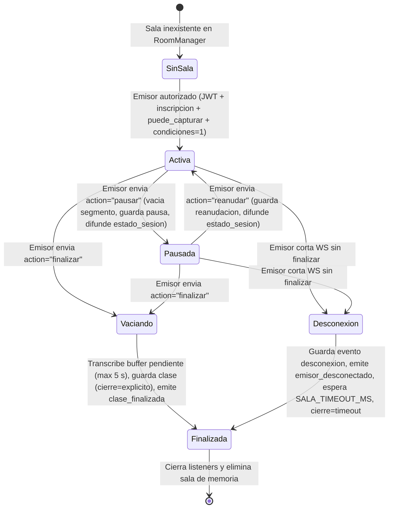

# Documentación Técnica y Guía de Defensa — Puente LSCh

**Estado del repositorio documentado:** hasta `SPEC-009` (PoC completa y verificada, con resultados reproducibles en `docs/resultados_poc.md` y registro de decisiones en `docs/decisiones_tecnicas.md`).  
**Propósito:** reunir en un único documento todo lo que está efectivamente construido en código, cómo funciona internamente cada pieza, qué decisiones técnicas lo respaldan, qué limitaciones existen hoy y cómo defender el proyecto frente a preguntas técnicas, metodológicas o normativas de la comisión evaluadora.

---

## 1. Visión general y alcance real hoy

**Puente LSCh** es una aplicación web progresiva (PWA) cliente-servidor orientada a apoyar la inclusión de estudiantes sordos en aulas universitarias de la Universidad del Bío-Bío. Durante una clase presencial, captura la voz del docente, la transcribe en tiempo real como subtítulos continuos, detecta conceptos clave de un glosario del curso mediante procesamiento de lenguaje natural (`spaCy`) y despliega los clips de Lengua de Señas Chilena (LSCh) asociados, dejando además un historial consultable con lectura de apunte y reproducción en diferido (*replay*).

### Qué está implementado vs qué sigue pendiente

| Bloque | Estado | Qué cubre | Referencia |
|---|---|---|---|
| **Fundación y eco WebSocket** | Implementado | Estructura `backend/`, `frontend/`, `ml/`, Docker Compose, `/health` | `SPEC-001` |
| **Núcleo backend modular** | Implementado | FastAPI, SQLite, `spaCy`, `RoomManager`, endpoints iniciales | `SPEC-002` |
| **PWA y flujo en vivo** | Implementado | React + Vite PWA, captura de audio, subtítulos y reproductor | `SPEC-003` |
| **Perfil estudiante, salas fan-out e historial** | Implementado | Login RUT+JWT, salas `[COD_RAMO]-[SECCION]`, historial y replay | `SPEC-004` |
| **Auditoría UX y cierre de salas** | Implementado | Auth Bearer en REST, reconexión WS con backoff, manejo de errores y cierre real | `SPEC-005` |
| **Transcripción real (PCM + faster-whisper)** | Implementado | `AudioWorklet` 16 kHz s16le, `Segmentador` RMS, `FasterWhisperProvider` local, retiro de Google | `SPEC-006` |
| **Glosario piloto, clips de ensayo y matching v2** | Implementado | Curso piloto provisional `INF-221` (15 conceptos) + control `MAT-101`, 15 MP4 de ensayo, doble clave + bloqueos + abstenciones, cola acotada | `SPEC-007` |
| **Mediciones cuantitativas de la PoC** | Implementado (brecha acústica R9 declarada) | Instrumentación `metrica_segmento`, `evaluar_asr.py`, `evaluar_matching.py`, `prueba_carga.py`, 2 audios propios (`~6.7` y `~6.9` min, condición cercana) y resultados en `docs/resultados_poc.md` | `SPEC-008` |
| **Acceso por inscripción, pausa compartida y seguridad** | Implementado | Permiso `puede_capturar`, autorización en WS/glosario/estado/clips, pausa en servidor con discontinuidades y cierre `explicito\|timeout`, aviso de condiciones, `scrypt`, JWT 480 min, CORS acotado, saneamiento y `docs/decisiones_tecnicas.md` | `SPEC-009` |
| **Co-diseño PIESDI y banco real (80–150 términos)** | Fuera de software (`OE1`) | Acuerdo con docente, validación con intérpretes y grabación real | Propuesta / Informe |

### Decisión estructural clave: el paradigma centrado en el estudiante
Originalmente (`SPEC-001` a `SPEC-003`) existían dos vistas separadas ("Soy profesor" y "Soy alumno"). A partir de `SPEC-004` (y reforzado en `SPEC-009`), la plataforma se estructuró bajo un **perfil único centrado en el estudiante**:
* **Por qué:** el docente no necesita operar la aplicación ni iniciar sesión durante la cátedra. Un estudiante inscrito con permiso explícito de captura (`inscripcion.puede_capturar`) conecta un micrófono (idealmente lavalier inalámbrico) a su dispositivo y entrega el transmisor al docente.
* **Emisor único autorizado + Fan-out (1 → N):** solo un usuario con permiso `puede_capturar` (tras confirmar el aviso de condiciones) puede actuar como **emisor** (`rol=emitter`), capturando y enviando audio. Los demás estudiantes inscritos en la sección entran como **oyentes** (`rol=listener`) y reciben exactamente la misma transcripción, estado de pausa y señas sin duplicar la inferencia ASR.

---

## 2. Arquitectura y flujo de datos en tiempo real

### 2.1 Diagrama de componentes y flujo en vivo

```mermaid
flowchart LR
    Mic["Micrófono (dispositivo emisor)"] --> AW["AudioWorklet (pcm-worklet.js, 16 kHz s16le, 100 ms)"]
    AW -->|"Binario 3200 B cada 100 ms"| WS["WebSocket /ws/sala/{room_id}"]
    WS --> Q["asyncio.Queue (backend/app/main.py)"]
    Q --> ASR["FasterWhisperProvider / StubAsrProvider"]
    ASR --> Seg["Segmentador RMS (subtramas 30 ms, pre-roll 240 ms)"]
    Seg -->|"Ventanas PCM float32"| WM["WhisperModel (CTranslate2, CUDA/CPU, Lock único)"]
    WM -->|"final: false (cada 1 s)"| Br["RoomManager.broadcast"]
    WM -->|"final: true (silencio 600 ms / 15 s / pausa / cierre)"| NLP["spaCy + Indice (doble clave y bloqueos)"]
    NLP -->|"senas + abstenciones"| DB[("SQLite WAL (evento_clase)")]
    NLP -->|"Solo senas (sin abstenciones)"| Br
    Br -->|"JSON segmento / estado_sesion"| Em["Emisor (SalaView.jsx)"]
    Br -->|"JSON segmento / estado_sesion"| Oy["Oyentes (SalaView.jsx)"]
    Em --> UI["Subtítulos por segment_id + useColaSenas + SenaPlayer (blob:)"]
    Oy --> UI
```



### 2.2 Ciclo de vida de una sesión (`ws_sala`)



### 2.3 Separación de provisionales y finales (regla `RN10`)
1. Mientras el docente habla sin pausas mayores a `ASR_SILENCIO_MS` (600 ms), el `Segmentador` emite ventanas provisionales cada `ASR_PARCIAL_MS` (1000 ms) con el mismo `segmento_id`.
2. El servidor difunde las provisionales con `"final": false` y `"senas": []` — **no ejecuta matching NLP ni escribe en `evento_clase`**. Así se evita disparar clips erróneos si Whisper corrige una palabra al avanzar la frase, y no se ensucia el historial.
3. Cuando hay 600 ms de silencio tras voz, el segmento alcanza 15 s (`ASR_MAX_SEGMENTO_MS`), dejan de llegar tramas por 600 ms, el emisor pausa la sesión o finaliza la clase, se emite la ventana final (`estable=True`) con el **mismo `segmento_id`**.
4. Solo entonces el backend ejecuta `buscar_terminos(texto, sala.indice)` sobre el texto consolidado, inserta **una sola fila** en `evento_clase` (`tipo='segmento'`, con `senas_json` y `abstenciones_json`), y difunde `"final": true` únicamente con la lista `senas` (las abstenciones no se envían al cliente).
5. En el frontend (`SalaView.jsx`), los subtítulos se indexan y reemplazan por `segment_id` (resaltando el tramo exacto `texto_detectado`), y las señas entran a la cola secuencial (`useColaSenas`) sin bucle, reproduciendo clips autenticados desde memoria (`blob:`).

---

## 3. Decisiones técnicas y su justificación

Esta sección responde a preguntas del tipo *"¿por qué usaron tecnología X en vez de Y?"* (ver tabla formal de divergencias respecto al informe/plan en `docs/decisiones_tecnicas.md`).

| Decisión | Alternativa descartada / del informe | Justificación en el prototipo |
|---|---|---|
| **Python 3.11/3.14 + FastAPI** | Node.js + Express | El ecosistema de audio, ASR (`faster-whisper`), NLP (`spaCy`) y evaluación (`pytest`, `jiwer`) vive nativo en Python; FastAPI aporta WebSockets ASGI asíncronos y validación Pydantic sin capa extra. |
| **PWA React + Vite (JS)** | App móvil nativa o TypeScript | Un único código corre en computador, tablet y celular sin pasar por tiendas. Se usó JavaScript (divergiendo de TypeScript del informe) para priorizar velocidad de iteración en la PoC. El routing por hash (`#/...`) evita configurar reescrituras SPA complejas durante desarrollo. |
| **Captura con `AudioWorklet` (PCM s16le 16 kHz)** | `MediaRecorder` (WebM/Opus) | `MediaRecorder` (usado hasta `SPEC-005`) solo incluye cabecera WebM en el primer fragmento: los trozos siguientes no son decodificables de forma aislada y una reconexión rompe el stream. PCM 16 kHz mono a 16 bits es el formato nativo de Whisper (32 kB/s exactos) y permite segmentación determinista por energía. |
| **Remuestreo lineal en el worklet** | Asumir `AudioContext` a 16 kHz | Navegadores móviles, Firefox o controladores de audio de Windows suelen forzar 44.1 kHz o 48 kHz aunque se solicite 16 kHz. El procesador `pcm-worklet.js` detecta `sampleRate` global y remuestrea en tiempo real con interpolación lineal sin pérdida de continuidad entre bloques de 128 muestras. |
| **`faster-whisper` local** | Google Cloud Speech-to-Text / Web Speech API | El adaptador anterior de Google (`google_streaming.py`) estaba incompleto, no tenía credenciales y requería enviar voz a un tercero (restringido por autorización y Leyes 19.628 / 21.719). Web Speech API solo opera en motores Chromium y depende de la nube de Google. `faster-whisper` corre offline sobre CTranslate2 (`float16` en GPU CUDA / `int8` en CPU), sin costo por minuto ni fuga de audio. |
| **`Segmentador` por RMS + `vad_filter`** | Enviar todo el audio crudo al modelo o usar Silero continuo | Whisper no es un modelo streaming puro sino de ventanas. Detectar energía RMS en subtramas de 30 ms con pre-roll de 240 ms permite ignorar silencio sin gastar GPU/CPU, controlar el ritmo de provisionales (`1000 ms`) y omitir provisionales si hay atraso (`> ASR_PARCIAL_MS`). Whisper además aplica su filtro de voz interno (`vad_filter=True`) y `condition_on_previous_text=False` para evitar alucinaciones repetitivas en silencios. |
| **`spaCy` (`es_core_news_md`) + doble clave + bloqueos** | Matching exacto por substring, lemas manuales o LLM generativo | El matching exacto falla ante flexiones y mantener lemas a mano rompe cuando cambia el contexto. El sistema indexa automáticamente cada `forma` con **doble clave** (lemas y forma en minúscula, excluyendo `DET`, `ADP`, `CCONJ`, `SCONJ` y puntuación) buscando el n-grama más largo dinámicamente y preservando `texto_detectado` original. Los `bloqueos` conservan preposiciones/artículos (ej. `"de memoria"`) para abstenerse en usos ambiguos conocidos sin inventar señas. |
| **Cola acotada de señas y tarjetas de ensayo (`ffmpeg`)** | Mostrar todas las señas en bucle por 4 s o usar videos propios | Reproducir clips sin límite genera retraso creciente respecto al habla (§4.1.4). `useColaSenas` reproduce una seña completa a la vez (sin bucle), limita la cola a **3 pendientes** (descarta la más antigua avisando `"disponibles en el historial"`) y omite menciones repetidas del mismo concepto durante **20 s**. Como no hay validación lingüística con PIESDI, las señas no se inventan (`RN08`): los MP4 son tarjetas de ensayo sin personas, rotuladas en pantalla y servidas tras autenticación e inscripción. |
| **SQLite con modo WAL (conexión por hilo)** | PostgreSQL | Para la PoC (2 cursos, decenas de términos y sesiones locales), SQLite con `WAL`, `busy_timeout=5000`, `foreign_keys=ON` y conexiones por hilo (`threading.local()`) elimina la gestión de otro servicio manteniendo integridad relacional y concurrencia segura ante descargas paralelas de clips. |
| **`RoomManager` en memoria** | Redis Pub/Sub / Kafka | Con un único proceso Uvicorn, mantener salas y sets de WebSockets en memoria da latencia mínima (microsegundos) sin dependencias extra. Limitación asumida para Proyecto de Título: no escala horizontalmente a múltiples workers ni soporta recuperación por secuencia ante reconexiones. |
| **Nginx con HTTPS autofirmado + Cloudflare Tunnel** | HTTP plano | Las APIs web `getUserMedia`, `AudioWorklet` y la instalación como PWA **exigen contexto seguro** (`localhost` o HTTPS). Para probar desde celulares en red local se genera una CA propia y certificado con SAN para la IP local, además de soporte opcional para Cloudflare Tunnel (`wss://` automático). |

---

## 4. Arquitectura detallada del Backend (`backend/`)

### 4.1 Estructura de módulos

```text
backend/
├── app/
│   ├── main.py                      # App FastAPI, lifespan, CORS acotado, /api/cursos, glosario, clips protegidos, /ws/sala
│   ├── asr/
│   │   ├── base.py                  # ResultadoASR, StreamingASRProvider, AsrConfigError, get_asr_provider()
│   │   ├── segmentador.py           # Segmentador por energía RMS (30 ms) + Ventana
│   │   ├── whisper_local.py         # FasterWhisperProvider, caché singleton de WhisperModel, vaciado en pausa (b"") y locks
│   │   └── stub.py                  # StubAsrProvider (8 frases de INF-221 para desarrollo/tests)
│   ├── auth/
│   │   └── routes.py                # POST /api/auth/login (scrypt), GET /api/auth/usuario/me
│   ├── core/
│   │   ├── auth.py                  # crear_token (JWT_EXP_MIN), verificar_token, obtener_rut, hash_password/verificar_password (scrypt)
│   │   ├── config.py                # Settings (pydantic-settings), JWT_SECRET aleatorio con warning si vacío, CORS_ORIGINS
│   │   ├── db.py                    # Conexiones SQLite WAL por hilo (threading.local), init_schema(), migraciones
│   │   ├── nlp.py                   # Singleton get_nlp() cargando spacy.load("es_core_news_md")
│   │   └── permisos.py              # resolver_sala(), inscripcion(), inscripcion_en_curso(), exigir_inscripcion*()
│   ├── evaluation/
│   │   └── metricas.py              # registrar_segmento() en metrica_segmento (controlado por METRICAS)
│   ├── glossary/
│   │   ├── indice.py                # construir_indice() (doble clave + bloqueos), obtener_indice_curso()
│   │   ├── matching.py              # buscar_terminos(texto, indice) → Coincidencias(senas, abstenciones)
│   │   └── repository.py            # ensure_schema(), list_terminos() (con ruta protegida), obtener_termino_video()
│   ├── historial/
│   │   ├── repository.py            # crear_clase (condiciones), finalizar_clase (cierre), guardar_evento (tipo), listar/obtener
│   │   └── routes.py                # GET /api/historial, GET /api/historial/{id}, GET /api/salas/{id}/estado (403/puede_capturar)
│   ├── salas/
│   │   └── manager.py               # RoomState (Indice, estado activa/pausada, estado_ts_ms) y RoomManager (pub/sub en memoria)
│   └── signs_recognition/
│       └── __init__.py              # Placeholder vacío (módulo secundario alumno→profesor, fuera de PoC)
├── data/
│   ├── schema.sql                   # Definición de las 7 tablas SQLite (con puede_capturar, cierre, condiciones, tipo)
│   ├── seed_glosario.json           # Datos semilla provisionales (INF-221 15 conceptos, MAT-101 control, 3 usuarios)
│   └── videos_senas/                # 15 clips MP4 de ensayo (H.264, 640×360, 3 s) servidos solo vía endpoint protegido
├── scripts/
│   ├── generar_clips_ensayo.py      # Genera tarjetas MP4 de ensayo con ffmpeg sin sobrescribir
│   └── seed_glosario.py             # Poblamiento destructivo/idempotente (scrypt vía app.core.auth) y validación de índice
├── tests/                           # Suite pytest (72 pruebas totales: 71 activas + 1 -m modelo)
├── Dockerfile                       # Imagen python:3.11-slim + libgomp1 + es_core_news_md + seed
└── requirements.txt                 # Dependencias Python fijadas
```

### 4.2 Flujo interno del módulo ASR (`app/asr/`)

1. **`base.py`:**
   * `ResultadoASR(segmento_id, texto, estable, inicio_ms, fin_ms, llegada_fin_ms=0, asr_ms=0)`: contrato único que devuelven tanto el stub (con tiempos en `0`) como `FasterWhisperProvider`.
   * `get_asr_provider(provider=None)`: fábrica que lee `ASR_PROVIDER` (`"whisper"` o `"stub"`). Cualquier otro valor lanza `AsrConfigError` indicando las opciones válidas (`whisper | stub`).
2. **`segmentador.py`:**
   * Recibe tramas binarias `s16le` (`<i2` little-endian), valida longitud par y las normaliza a `float32` en `[-1, 1]`.
   * Procesa en subtramas fijas de **30 ms (480 muestras)** acumulando residuos entre tramas de 100 ms.
   * Calcula `rms = sqrt(mean(sub**2))` y compara contra `umbral_rms = 0.01`.
   * **Pre-roll (240 ms):** guarda hasta 8 subtramas silenciosas previas en un `deque`; al detectarse voz, las antepone al segmento para no cortar el ataque consonántico de la primera palabra.
   * **Disparo provisional:** cada `parcial_ms` (1000 ms) desde el inicio/último parcial mientras el segmento sigue abierto (`final=False`).
   * **Disparo final (`final=True`):** cuando se acumulan `silencio_ms` (600 ms) de silencio tras voz, cuando el segmento alcanza `max_segmento_ms` (15000 ms) o al invocar `cerrar()`.
3. **`whisper_local.py` (`FasterWhisperProvider`):**
   * **Carga única:** `_cargar_whisper_model()` mantiene un diccionario `_MODELO_CACHE` protegido por `_MODELO_LOCK`. En `main.py`, el `lifespan` invoca `get_asr_provider()` al arrancar si `ASR_PROVIDER=whisper`, fallando rápido con `AsrConfigError` en español si falta el paquete o falla el modelo.
   * **Resolución de dispositivo (`WHISPER_DEVICE`):**
     * `auto`: consulta `ctranslate2.get_cuda_device_count()`. Si hay GPU, intenta `device="cuda"` con `float16`; si falla o no hay CUDA, registra `logger.warning` y cae a `device="cpu"` con `int8`.
     * `cuda` o `cpu` explícitos: fuerzan el dispositivo correspondiente (lanzando `AsrConfigError` si falla).
   * **Ejecución no bloqueante y exclusión mutua:** cada ventana se ejecuta en un hilo separado vía `asyncio.to_thread`, serializada con un `asyncio.Lock` por event loop (`_ASYNC_LOCKS`) y `_MODELO_LOCK`, impidiendo que dos salas concurrentes compitan sobre el mismo `WhisperModel`.
   * **Manejo de falta de tramas, pausa y atraso:** una tarea `_pump` vuelca `audio_iter` a una `asyncio.Queue` llevando la cuenta exacta de `queued_bytes`:
     * Si no llegan tramas durante `ASR_SILENCIO_MS`, `asyncio.wait_for` vence y ejecuta `segmentador.cerrar()`, consolidando la frase abierta.
     * Al recibir una trama vacía `b""` (enviada por `_receiver` cuando el emisor pausa), ejecuta `segmentador.cerrar()` para consolidar inmediatamente el segmento abierto sin cerrar el stream.
     * Al drenar la cola tras una inferencia, si había más de `ASR_PARCIAL_MS` de audio pendiente, `_filtrar_ventanas` conserva **todas** las ventanas finales pero omite las provisionales hasta ponerse al día.
   * **Parámetros de inferencia:** `language` normalizado (`"es-CL"` → `"es"`), `vad_filter=True`, `condition_on_previous_text=False` e `initial_prompt` armado con la lista deduplicada de `texto_visible` del glosario si `ASR_PROMPT_GLOSARIO=true`.
4. **`stub.py` (`StubAsrProvider`):**
   * Vigila `audio_iter` en segundo plano para detenerse inmediatamente cuando la sala finaliza (`None` en la cola), y mientras tanto emite cíclicamente las 8 frases de `FRASES` (orientadas al curso piloto `INF-221`, incluyendo conceptos y un caso bloqueado `"de memoria"`) cada `STUB_INTERVAL_MS` con `segmento_id` secuencial y tiempos simulados (suprimidos mientras la sala está pausada).

### 4.3 Índice y motor de coincidencia lingüística (`app/glossary/`)
1. **Construcción del índice (`indice.py` — `construir_indice` / `obtener_indice_curso`):**
   * Omite los términos con `estado == "retirado"`.
   * Para cada expresión declarada en `formas`, ejecuta `spaCy` (`es_core_news_md`) excluyendo `STOP_POS` (`DET`, `ADP`, `CCONJ`, `SCONJ`) y puntuación, registrando **dos claves**: la de lemas y la de formas en minúscula.
   * Calcula `max_ngrama` dinámicamente según la expresión más larga del índice (sin tope fijo de 3).
   * Si dos conceptos distintos del mismo curso producen la misma clave, lanza `ValueError` nombrando ambos conceptos (validado también al ejecutar `seed_glosario.py`).
   * Procesa los `bloqueos` conservando todas las palabras no puntuadas (incluidas preposiciones/artículos como `"de"` en `"de memoria"`), marcando `entradas[clave] = None` y fallando si colisiona con una forma sin ser más largo.
   * Cachea el `Indice` por `(DB_PATH, curso_id)` y lo invalida al resembrar.
2. **Búsqueda (`matching.py` — `buscar_terminos(texto, indice)`):**
   * Analiza el texto final con `spaCy` manteniendo dos vistas alineadas sobre el `doc` original: tokens completos (para bloqueos) y tokens filtrados sin `STOP_POS` (para formas).
   * En cada posición prueba primero los n-gramas más largos y, para cada longitud, consulta primero por clave de lemas y luego por clave de forma.
   * Si gana un bloqueo por longitud, consume esas palabras y agrega `{"bloqueo", "texto_detectado"}` a `Coincidencias.abstenciones` sin activar seña.
   * Si gana una forma, recupera el tramo exacto original `doc[tok_ini:tok_fin].text` como `texto_detectado` y agrega `{termino_id, texto_visible, video_url, estado, texto_detectado}` a `Coincidencias.senas`.

### 4.4 Gestión de salas, pausa compartida, vaciado y cierre (`app/main.py` y `app/salas/manager.py`)
* `RoomManager` administra `_salas: dict[str, RoomState]` con locks indexados por event loop (`WeakKeyDictionary`) para soportar múltiples loops de `pytest` y concurrencia asíncrona en producción.
* Al conectarse a `/ws/sala/{room_id}`:
  1. Valida token JWT (`verificar_token`), existencia de la sala (`resolver_sala`) e inscripción del RUT en curso y sección (`inscripcion`). Cualquier fallo envía `{"type": "error", "mensaje": "No tienes acceso a esta sala"}` y cierra sin crear sala ni clase.
  2. Si `rol=emitter`, exige además `puede_capturar == True`, `condiciones == "1"` y que no exista ya una sala activa para ese `room_id`.
  3. Instancia el proveedor ASR antes de crear la sala (si falla la configuración, cierra con error sin dejar sala huérfana), carga/obtiene el `Indice` del curso, arma el `contexto` si `ASR_PROMPT_GLOSARIO=true`, crea el `RoomState` e inserta el registro inicial en `clase` con `condiciones_confirmadas = 1`.
  4. Si `rol=listener`, se registra atómicamente en `RoomManager.agregar_listener` y recibe de inmediato `{"type": "estado_sesion", "estado": "activa" | "pausada", "timestamp_ms": ...}` con el estado vigente.
* **Validación de tramas binarias y pausa en `_receiver`:**
  * Mientras `sala.estado == "pausada"`, descarta toda trama binaria entrante. En estado activo descarta tramas con longitud impar o `> ASR_MAX_TRAMA_BYTES` (64000 bytes), emitiendo un único `logger.warning` por sesión.
  * Ante `{"action": "pausar"}`: cambia el estado a `"pausada"`, encola `b""` para vaciar el segmento abierto, persiste un evento `tipo="pausa"` en `evento_clase` y difunde `estado_sesion`.
  * Ante `{"action": "reanudar"}`: vuelve a `"activa"`, persiste un evento `tipo="reanudacion"` y difunde `estado_sesion`.
* **Finalización explícita vs desconexión abrupta:**
  * Si recibe `{"action": "finalizar", "titulo": ...}`: encola `None` en `audio_queue`, espera a `_transcribir` hasta `ASR_FLUSH_TIMEOUT_MS` (5000 ms) para consolidar el último tramo hablado, marca `cierre="explicito"` en `clase` y emite `clase_finalizada`.
  * Si el emisor corta la conexión sin finalizar: guarda un evento `tipo="desconexion"`, difunde `emisor_desconectado`, espera `SALA_TIMEOUT_MS` (30000 ms en prod, 100 ms en tests), guarda la clase con `cierre="timeout"`, difunde `clase_finalizada` y cierra todos los WebSockets oyentes.
  * El bloque `try ... finally` garantiza ejecutar `RoomManager.eliminar(room_id)` incluso si la tarea es cancelada.

### 4.5 Variables de configuración (`app/core/config.py`)

| Variable | Por defecto | Descripción |
|---|---|---|
| `PORT` | `8000` | Puerto del servidor FastAPI |
| `ASR_PROVIDER` | `"stub"` | Proveedor activo: `"stub"` o `"whisper"` |
| `WHISPER_MODEL` | `"small"` | Modelo de `faster-whisper` (`tiny`, `base`, `small`, etc.) |
| `WHISPER_DEVICE` | `"auto"` | `"auto"` (intenta CUDA y cae a CPU), `"cuda"` o `"cpu"` |
| `WHISPER_COMPUTE_TYPE` | `"auto"` | `"auto"` (`float16` en CUDA, `int8` en CPU) o tipo explícito |
| `ASR_SILENCIO_MS` | `600` | Silencio o ausencia de tramas (ms) que cierra un segmento |
| `ASR_MAX_SEGMENTO_MS` | `15000` | Duración máxima de un segmento continuo (ms) |
| `ASR_PARCIAL_MS` | `1000` | Cadencia mínima de resultados provisionales (ms) |
| `ASR_FLUSH_TIMEOUT_MS` | `5000` | Espera máxima para vaciar el búfer al finalizar la clase (ms) |
| `ASR_MAX_TRAMA_BYTES` | `64000` | Límite de bytes aceptados por mensaje binario PCM |
| `ASR_PROMPT_GLOSARIO` | `True` | Inyectar `texto_visible` del glosario como `initial_prompt` |
| `SPACY_MODEL` | `"es_core_news_md"` | Modelo de `spaCy` cargado por `get_nlp()` |
| `DB_PATH` | `backend/data/glosario.db` | Ruta del archivo SQLite |
| `STUB_INTERVAL_MS` | `1500` | Intervalo entre frases en modo `stub` |
| `JWT_SECRET` | `""` (aleatorio si vacío) | Secreto HMAC-SHA256 para JWT (genera uno aleatorio con `logger.warning` si queda vacío) |
| `JWT_EXP_MIN` | `480` | Vigencia del token en minutos (8 horas, suficiente para una jornada de clases) |
| `CORS_ORIGINS` | `"http://localhost:5173"` | Lista separada por comas de orígenes CORS permitidos (`allow_credentials=False`) |
| `SALA_TIMEOUT_MS` | `30000` | Gracia tras desconexión abrupta del emisor antes de cerrar |
| `METRICAS` | `True` | Activa/desactiva el registro de tiempos en `metrica_segmento` |

---

## 5. Modelo de datos (`backend/data/schema.sql`) y estado actual del Seed

El esquema SQLite habilita `PRAGMA journal_mode=WAL` y `PRAGMA foreign_keys=ON`. Contiene 7 tablas:

1. **`curso`:** `(id PK, cod_ramo, nombre)`. Ej.: `1, "INF-221", "Estructuras de Datos"`.
2. **`termino`:** `(id PK, curso_id FK, texto_visible, formas_json, bloqueos_json, video_url, estado)`. Ya no almacena lemas manuales ni `n_palabras`; `estado` restringe `ensayo | publicado | retirado` vía `CHECK`. La columna `video_url` guarda el nombre de archivo interno y las rutas públicas se exponen vía `/api/cursos/{curso_id}/senas/{termino_id}/video`.
3. **`usuario`:** `(rut PK, password_hash, nombre, apellido)`. `password_hash` usa `hashlib.scrypt` con sal aleatoria de 16 bytes por usuario (`scrypt$16384$8$1$<sal>$<derivada>`).
4. **`inscripcion`:** `(rut FK, curso_id FK, seccion, puede_capturar, PK(rut, curso_id, seccion))`.
5. **`clase`:** `(id PK, room_id, curso_id FK, seccion, rut_emisor FK, fecha_inicio, fecha_fin, duracion_ms, titulo, cierre, condiciones_confirmadas)`. `cierre` toma `explicito | timeout`.
6. **`evento_clase`:** `(id PK, clase_id FK, timestamp_ms, texto, estable, senas_json, abstenciones_json, tipo)`. `tipo` distingue `segmento | pausa | reanudacion | desconexion`.
7. **`metrica_segmento`:** `(id PK, clase_id FK, segmento_id, audio_inicio_ms, audio_fin_ms, llegada_fin_ms, asr_ms, nlp_ms, emitido_ms, receptores)`. Instrumenta latencias con reloj monotónico por segmento final (las tablas obsoletas `sesion` y `segmento` de `SPEC-002` fueron retiradas).

### Datos sembrados actualmente (`backend/data/seed_glosario.json`)
* **2 cursos:**
  * `INF-221` (*Estructuras de Datos*) — curso piloto **provisional** propuesto por el autor para la PoC (declarado en la clave `"nota"` del JSON y en `README.md`, sin acuerdo con PIESDI ni con un docente), con **15 conceptos** en `estado="ensayo"`: *arreglo, lista enlazada, pila, cola, árbol binario, nodo, puntero, grafo, tabla hash, recursión, algoritmo, complejidad, ordenamiento, búsqueda binaria, memoria*.
  * `MAT-101` (*Álgebra Lineal*) — curso de control **sin términos** para verificar aislamiento entre salas.
* **3 usuarios de prueba (password `test123`, RUT con dígito verificador válido, hashes `scrypt` únicos):**
  * `12345678-5` — Juan Pérez (inscrito en `INF-221` sec. `1` y `MAT-101` sec. `3`, `puede_capturar=1`).
  * `9876543-3` — María González (inscrita en `INF-221` sec. `1` y `MAT-101` sec. `3`, `puede_capturar=0`).
  * `11111111-1` — Pedro Soto (inscrito solo en `MAT-101` sec. `3`, `puede_capturar=0` — pruebas negativas `CA01`).
* **15 clips MP4 de ensayo** en `backend/data/videos_senas/` (8.2–10.6 kB cada uno, H.264 640×360, 3 s, `-movflags +faststart`), generados por `backend/scripts/generar_clips_ensayo.py` con tarjetas de texto (`"CLIP DE ENSAYO"`, concepto, `"Sin validación lingüística"`) sin personas y **versionados en Git** para que un clon limpio arranque sin pasos manuales.

### Datos y corpus para evaluación (`ml/`)
* **`ml/datos/frases_anotadas.jsonl` y `ml/datos/README.md`:** 102 frases anotadas sobre los 15 conceptos de `INF-221` — **66 de `"prueba"`** (congeladas en el commit `04c6c7f` antes de ajustar formas/bloqueos en `SPEC-007`, cumpliendo `RNF04`) y **36 de `"ajuste"`**. Incluye frases sin conceptos, usos cotidianos ambiguos, compuestos y flexiones.
* **`ml/datos/guiones/`, `referencias/` y `audio/` (ignorado en Git):** dos guiones de clase de `INF-221` (`982` y `899` palabras), sus grabaciones con voz del autor (`clase_01_cerca.wav` de `6 min 44.65 s` y `clase_02_cerca.wav` de `6 min 54.21 s`, en condición cercana silenciosa) y referencias revisadas contra audio; los resultados JSON trazables viven en `ml/resultados/` y su análisis completo en `docs/resultados_poc.md`.

---

## 6. Arquitectura del Frontend PWA (`frontend/`)

### 6.1 Estructura de módulos

```text
frontend/
├── public/icon.svg                    # Ícono SVG de la PWA
├── src/
│   ├── main.jsx                       # Punto de entrada React 18
│   ├── App.jsx                        # Router manual por window.location.hash
│   ├── App.css                        # Tema oscuro completo y diseño responsive
│   ├── api/
│   │   ├── cliente.js                 # Cliente fetch con Bearer, normalización RUT, manejo 401/403
│   │   └── clips.js                   # Descarga autenticada de clips a blob:, caché Map, precargar() y liberarClips()
│   ├── audio/
│   │   ├── pcm-worklet.js             # AudioWorkletProcessor (resampling a 16 kHz, Int16 LE, RMS)
│   │   └── capturaPcm.js              # Ciclo de captura: iniciar, pausar, reanudar, detener
│   ├── hooks/
│   │   ├── useAuth.js                 # Persistencia de sesión en localStorage y evento puente-auth-expired
│   │   ├── useColaSenas.js            # Cola secuencial (máx. 3 pendientes) y ventana 20 s anti-repetición
│   │   └── useWebSocket.js            # Reconexión con backoff exponencial [3, 6, 12, 24] s (máx 5) y detener()
│   ├── components/
│   │   ├── Header.jsx                 # Navbar con logo, tabs Inicio/Historial y avatar
│   │   ├── EstadoConexion.jsx         # Indicador visual conectado/reconectando/desconectado/fallo
│   │   ├── Feedback.jsx               # Banner visual de error/warning/info
│   │   ├── CondicionesModal.jsx       # Aviso informativo y confirmación obligatoria previa a capturar (RN15)
│   │   ├── FinalizarModal.jsx         # Modal para asignar título opcional al cerrar clase
│   │   └── SenaPlayer.jsx             # Reproductor <video> desde blob: sin bucle, velocidad, pausa y rótulo de ensayo
│   └── views/
│       ├── LoginView.jsx              # Formulario RUT + contraseña + botón Instalar PWA
│       ├── DashboardView.jsx          # Clase actual + grid de asignaturas, estado en vivo y botones según puede_capturar
│       ├── SalaView.jsx               # Vista en vivo (emisor PCM / oyente + pausa compartida + precarga clips)
│       ├── HistorialView.jsx          # Buscador, filtros asignatura/mes, cards y badge "Registro incompleto"
│       └── ClaseDetailView.jsx        # Modos Apunte (con separadores) y Replay continuo (1x/1.5x/2x)
├── vite.config.js                     # Configuración Vite 5 + VitePWA (autoUpdate, manifest, sw.js)
├── nginx.conf                         # Reverse proxy HTTPS/SSL y proxy WS/API (sin /data/ público)
├── Dockerfile                         # Build Node 20 + pnpm → nginx:alpine con openssl
└── docker-entrypoint.sh               # Sustituye BACKEND_UPSTREAM y genera CA/cert autofirmados
```

### 6.2 Captura PCM en el navegador (`src/audio/`)
1. **`capturaPcm.js` (`iniciar({ onTrama, onNivel })`):**
   * Solicita micrófono con `getUserMedia({ audio: { channelCount: 1, echoCancellation: false, noiseSuppression: false, autoGainControl: true } })` (evitando bloqueos de WASAPI/Bluetooth con cancelación de eco, ya que la app no reproduce voz del docente por parlantes).
   * Crea `AudioContext()` a la frecuencia nativa del hardware (evitando silencios en Windows/Firefox al forzar 16 kHz) y delega el remuestreo a `pcm-worklet.js`.
   * Carga `pcm-worklet.js` vía `new URL('./pcm-worklet.js', import.meta.url)` (que Vite empaqueta inline en producción para operar incluso en PWA).
   * Conecta `MediaStreamSource → AudioWorkletNode (1 canal explícito) → GainNode (ganancia 0) → AudioContext.destination` (necesario en Chromium para asegurar la ejecución continua del grafo sin acoplamiento acústico por parlantes).
   * Expone `pausar()` (ignora tramas sin destruir el stream), `reanudar()` (resetea acumuladores del worklet para no enviar audio antiguo) y `detener()` (desconecta nodos, detiene pistas del micrófono y cierra el `AudioContext`).
2. **`pcm-worklet.js` (`PcmProcessor`):**
   * Si `sampleRate === 16000`, acumula directamente muestras `Float32`; si es distinto (ej. 44100 o 48000 Hz), aplica interpolación lineal continua manteniendo cola de residuo (`_inTail`) y fase fraccionaria (`_inPos`) entre llamadas de `process()`.
   * Cada **1600 muestras (100 ms)** calcula la energía RMS y escribe un `ArrayBuffer` de **3200 bytes** en formato entero de 16 bits *little-endian* mediante `DataView.setInt16(..., true)`, transfiriéndolo por `port.postMessage({ buffer, rms }, [buffer])` sin copia de memoria.

### 6.3 Vistas y experiencia de usuario
* **Login (`LoginView.jsx`):** valida formato y dígito verificador chileno módulo 11 (`normalizarRut`) antes de llamar al servidor; persiste la sesión al recargar o abrir nuevas pestañas (`useAuth.js`); gestiona `beforeinstallprompt` (o guía manual de Chrome) para instalar la PWA.
* **Dashboard (`DashboardView.jsx`):** consulta las asignaturas inscritas con `puede_capturar` y el estado en vivo de cada sala (`GET /api/salas/{roomId}/estado`), mostrando `"En vivo"` / `"Entrar a la clase"` cuando hay transmisión activa, `"Iniciar Transmisión de Clase"` solo si el usuario tiene `puede_capturar`, y `"Sin clase activa"` sin botón de inicio en caso contrario.
* **Sala en vivo (`SalaView.jsx`):**
  * **Acceso y precarga:** verifica estado/permisos al entrar (`403` muestra `"No tienes acceso a esta sala"`; sin transmisión y sin permiso muestra `"Aún no hay una transmisión en esta sala"` sin asumir rol emisor). Descarga en segundo plano (máx. 4 en paralelo) los clips del glosario vía `clips.js` y libera las URLs `blob:` al salir (`liberarClips()`).
  * **Emisor y condiciones (`CondicionesModal`):** antes de solicitar micrófono exige confirmar qué se guarda (texto y señas; el audio no se almacena), quién puede consultarlo, falta de política institucional de conservación y que no reemplaza la autorización del curso (`RN15`); solo tras confirmar conecta con `&condiciones=1`. Muestra medidor visual de nivel de señal (`.nivel-audio`), contador `mm:ss`, aviso `"No se detecta audio en el micrófono"` tras 10 s bajo `UMBRAL_SILENCIO` (0.004), pausa/reanudación sincronizada vía WS (`{"action": "pausar" | "reanudar"}`) y cierre con título (`FinalizarModal`).
  * **Pausa compartida:** al recibir `estado_sesion` (`pausada`), tanto el emisor como todos los oyentes (incluso quienes se unen durante la pausa) ven el banner `"Transmisión en pausa"` y la insignia `EN PAUSA`.
  * **Subtítulos:** actualiza o inserta entradas por `segment_id` (sin duplicar ni perder el lugar), resalta el tramo real reconocido (`texto_detectado || texto_visible`) con `<strong class="termino">` —destacando incluso variantes como *"listas ligadas"* o *"recursiva"*— y persiste el tamaño de letra (`12–32 px`) en `localStorage`.
  * **Cola de señas (`useColaSenas` + `SenaPlayer`):** descarga cada clip con cabecera `Authorization: Bearer` a una URL de objeto `blob:` reutilizada en caché (`clips.js`), reproduce **un clip completo a la vez sin bucle** y avanza al siguiente vía `onEnded` (con recuperación de 1.5 s ante error). Admite hasta **3 pendientes** (descarta el más antiguo avisando `"disponibles en el historial"`) y omite menciones repetidas del mismo concepto durante **20 s**. Cuando `estado === "ensayo"`, muestra el rótulo `"Clip de ensayo · sin validación lingüística"`.
* **Historial y Detalle (`HistorialView.jsx`, `ClaseDetailView.jsx`):** búsqueda en tiempo real por título/ramo/preview, filtros por asignatura y mes, insignia **"Registro incompleto"** cuando `cierre === "timeout"`, vista **Apunte** (texto completo resaltado por `texto_detectado` con separadores visuales de *"Transmisión pausada"*, *"Transmisión reanudada"* y *"Emisor desconectado"* con marca de tiempo) y vista **Replay** (reproducción continua al ritmo de lectura y terminación completa de los clips `blob:` del segmento, saltando separadores sin detenerse, respetando Play/Pausa real y velocidad `1x/1.5x/2x`, con barra deslizante y salto por clic).

---

## 7. Contratos de API HTTP y WebSocket

### 7.1 Endpoints REST

| Método | Ruta | Autenticación | Descripción / Respuesta |
|---|---|---|---|
| `GET` | `/health` | Pública | `{"status": "ok"}` |
| `POST` | `/api/auth/login` | Pública | Recibe `{rut, password}`; valida hash `scrypt` con `hmac.compare_digest` y devuelve `{token, rut, nombre, apellido}` o `401` |
| `GET` | `/api/auth/usuario/me` | `Bearer` | Datos del usuario autenticado y sus inscripciones con `puede_capturar` (`401` si falta/inválido) |
| `GET` | `/api/cursos` | `Bearer` | Lista cursos inscritos del RUT del token (`id, cod_ramo, nombre, seccion, puede_capturar`) |
| `GET` | `/api/cursos/{curso_id}/glosario` | `Bearer` + inscripción | Lista términos del curso con `video_url` protegida (`403` si no está inscrito) |
| `GET` | `/api/cursos/{curso_id}/senas/{termino_id}/video` | `Bearer` + inscripción | Sirve el clip `video/mp4` desde DB (`401` sin token, `403` sin inscripción, `404` si retirado o inexistente) |
| `GET` | `/api/salas/{room_id}/estado` | `Bearer` + inscripción | Devuelve `{room_id, curso_id, activa, puede_capturar}` sin `rut_emisor` (`403` si no está inscrito) |
| `GET` | `/api/historial` | `Bearer` | Clases de las secciones donde el usuario está inscrito, con `cierre`, `palabras` y `preview` (solo `tipo='segmento'`) |
| `GET` | `/api/historial/{clase_id}` | `Bearer` | Detalle de clase (`cierre`) y sus eventos (`tipo`), exigiendo ser emisor o estar inscrito (`403` / `404`) |

### 7.2 Protocolo WebSocket (`/ws/sala/{room_id}?rol=emitter|listener&token=...&condiciones=1`)

* **Validaciones de acceso al conectar:** token JWT válido, sala válida e inscripción del RUT en el curso y sección (`No tienes acceso a esta sala`). Para `rol=emitter`, además exige `puede_capturar = 1` y `condiciones=1`.
* **Mensajes Cliente (emisor) → Servidor:**
  * **Trama binaria:** PCM s16le mono 16 kHz (3200 bytes = 100 ms; descartada si la sala está pausada o si tiene longitud impar / `> ASR_MAX_TRAMA_BYTES`).
  * **Texto JSON:** `{"action": "pausar"}`, `{"action": "reanudar"}`, `{"action": "finalizar", "titulo": "Texto opcional" | null}`.
* **Mensajes Servidor → Clientes (emisor y oyentes):**
  * **Estado de sesión (al conectarse un oyente y en cada pausa/reanudación):** `{"type": "estado_sesion", "estado": "activa" | "pausada", "timestamp_ms": 12340}`.
  * **Segmento provisional o final:**
    ```json
    {
      "type": "segmento",
      "segment_id": 1,
      "texto": "hoy vemos las listas enlazadas",
      "final": true,
      "senas": [
        {
          "termino_id": 2,
          "texto_visible": "lista enlazada",
          "video_url": "/api/cursos/1/senas/2/video",
          "estado": "ensayo",
          "texto_detectado": "listas enlazadas"
        }
      ],
      "timestamp_ms": 2150,
      "servidor_ms": 1795220781432
    }
    ```
  * **Desconexión inesperada del emisor:** `{"type": "emisor_desconectado", "mensaje": "..."}`.
  * **Cierre consolidado:** `{"type": "clase_finalizada", "clase_id": 1}` (seguido del cierre de WebSockets oyentes).
  * **Error de acceso o sala:** `{"type": "error", "mensaje": "..."}`.

---

## 8. Despliegue, HTTPS local y Cloudflare Tunnel

1. **Desarrollo nativo (recomendado para GPU CUDA en Windows):**
   * Backend en `backend/venv` (Python 3.14.0): `uvicorn app.main:app --port 8000` (con `$env:ASR_PROVIDER="whisper"` para inferencia real en GPU RTX 3050).
   * Frontend: `pnpm --prefix frontend dev` en `http://localhost:5173`.
2. **Docker Compose (`docker-compose.yml`):**
   * `backend`: imagen `python:3.11-slim` con `libgomp1`, `faster-whisper`, `es_core_news_md`; variables `ASR_PROVIDER`, `WHISPER_MODEL`, `WHISPER_DEVICE`, `JWT_SECRET`, `CORS_ORIGINS` y volumen persistente `whisper_cache` en `/root/.cache/huggingface`.
   * `frontend`: build multi-stage (Node 20 + pnpm → `nginx:alpine` + OpenSSL). Al arrancar, `docker-entrypoint.sh` sustituye `${BACKEND_UPSTREAM}` (por defecto `backend:8000`, configurable ej. a `host.docker.internal:8000` para apuntar a un backend nativo con GPU) y genera una CA autofirmada (`Puente LSCh Dev CA`) más un certificado TLS con SAN para `CERT_HOST` (`localhost` o IP local), exponiendo `/ca.crt` para instalar la CA en dispositivos móviles.
   * **Scripts de arranque:**
     * `run.ps1`: detecta la IPv4 local, construye y levanta `backend` y `frontend` con `CERT_HOST=$ip` e imprime los pasos para instalar el certificado en Android/Windows.
     * `run-cloudflare.ps1`: valida `CLOUDFLARE_TUNNEL_TOKEN` en `.env` y levanta el perfil `cloudflare` (`lsch_tunnel` apuntando a `http://frontend:80`), entregando HTTPS/WSS público sin configurar certificados en el celular.

---

## 9. Verificación y resultados cuantitativos de la PoC

| Verificación | Resultado observado | Alcance / Condición |
|---|---|---|
| `ruff check backend ml` | `All checks passed!` | Lint completo de `backend/` y `ml/` |
| `pytest backend/tests` | **71 passed, 1 skipped** | Cubre auth/scrypt/JWT/clips y concurrencia SQLite (14), historial/cierre/tipos (5), índice (4), matching (7), sala/WS/acceso/pausa (14), esquema SQLite (6), seed/clips (4), segmentador + `FasterWhisperProvider` con modelo simulado (17) |
| `pytest ml/tests` | **11 passed** | Cubre `normalizacion.py` (4), `evaluar_matching.py` (1), `evaluar_asr.py` (5), `prueba_carga.py` (1) |
| `pytest backend/tests -m modelo` | **1 passed** | Prueba de humo real cargando `WhisperModel('tiny')` en CUDA (verificada también tras `SPEC-009`) |
| `pnpm --prefix frontend build` | OK (48 módulos) | Genera bundle productivo y Service Worker PWA en `frontend/dist/` |
| Evaluación ASR real (`small` CUDA + prompt) | **WER `3.16–3.56 %` · p95 `805–821 ms`** | Sobre `clase_01_cerca.wav` (`404.65 s`) y `clase_02_cerca.wav` (`414.21 s`) a ritmo `1x`; glosario `100 %` (`57/57`) y `95.71 %` (`67/70`); detalle en `docs/resultados_poc.md` |
| Evaluación de matching (`"prueba"`) | **Prec. `96.34 %` · Rec. `97.53 %`** | Partición protegida de `66` frases (`TP=79, FP=3, FN=2`); compuestos `100 %` (`21/21`) |
| Carga WebSocket 5 min (`A` y `B`, `stub`) | **`0` perdidos/dup. · p95 `3–4 ms`** | `1+20` en 1 sala y `2 × (1+10)` en 2 salas (`3940` eventos entregados en c/u) sobre `localhost` |
| Prueba interactiva E2E en navegador (`SPEC-009`) | **Verificada (3 usuarios, 2 pestañas)** | Clips `401/404`, `CA01` (Pedro `403`), oyente sin captura (María), emisor + `CondicionesModal`, 2 pestañas sincronizadas en pausa/reanudación con `blob:` clips, cierre `timeout` (`Registro incompleto`) y Replay continuo; `0` errores HTTP/CORS/consola |

---

## 10. Limitaciones actuales conocidas (transparencia técnica)

Tras completar `SPEC-009` (acceso por inscripción, permiso de captura, clips protegidos, pausa compartida en servidor, discontinuidades, aviso de condiciones, `scrypt`, JWT 480 min y CORS acotado), las limitaciones vigentes del prototipo son:

1. **Glosario provisional y límites de desambiguación (`OE1` / alcance PoC):**
   * Aunque el glosario ya es coherente con `INF-221` y los clips son tarjetas MP4 reproducibles rotuladas como ensayo, siguen siendo recursos **sin validación lingüística ni participación de PIESDI**.
   * El mecanismo de `bloqueos` resuelve usos ambiguos conocidos de antemano (ej. `"de memoria"`, `"pila de cuadernos"`, `"hacer cola"`), pero las mediciones sobre `"prueba"` mostraron sus dos límites: `3` FP por contextos no vistos (*"cola larga"*, *"pila de pruebas"*, *"pila del micrófono"*) y `2` FN porque el bloqueo `"de memoria"` suprime compuestos técnicos reales (*"fuga de memoria"*, *"asignación de memoria"*).
2. **Límites de la evidencia cuantitativa obtenida en la PoC (`docs/resultados_poc.md`):**
   * El corpus ASR usa **voz única leída del autor** (no aula real espontánea) y ambas muestras (`6.7` y `6.9` min) quedaron grabadas con micrófono cercano en ambiente silencioso, dejando **pendiente la condición acústica con ruido ambiente o mayor distancia** (`R9`).
   * `RNF01` se midió solo en servidor (sin captura inicial de `100 ms`, red Wi-Fi real ni renderizado en receptor), la prueba de carga usó `ASR_PROVIDER=stub` en `localhost` y no hubo evaluación con usuarios sordos.
3. **Alcance diferido a Proyecto de Título (2027) y PIESDI:**
   * Co-diseño y banco real de 80–150 términos con PIESDI (`OE1`), reglas acotadas de ordenamiento de glosas (`RF15`), recuperación de eventos perdidos tras corte de red (`RF20`), reconexión del emisor a la misma clase, auditoría y políticas de conservación/eliminación (`RF28–RF29`), interfaz WCAG 2.2 AA (`RNF08`), administración de usuarios/cursos/permisos desde la app (`RF02–RF03`, `RF24–RF27`), inicio de sesión institucional y reconocimiento de señas por cámara (`signs_recognition/`).

---

## 11. Banco de preguntas frecuentes para la defensa

### Arquitectura y funcionamiento general
1. **¿Cómo funciona el sistema de punta a punta durante una clase real?**
   El estudiante inscrito y habilitado con `puede_capturar` abre la PWA, entra a su asignatura (`INF-221-1`), confirma el aviso de condiciones de registro (`CondicionesModal`) e inicia la transmisión. Mientras se precargan en segundo plano los clips protegidos del curso (`clips.js`), el navegador solicita el micrófono vía `getUserMedia`, captura mediante `AudioWorklet` tramas PCM mono a 16 kHz (3200 bytes cada 100 ms) y las envía por WebSocket (`/ws/sala/INF-221-1?rol=emitter&...&condiciones=1`) al backend FastAPI. En el servidor, `Segmentador` detecta voz por energía RMS y agrupa segmentos; `FasterWhisperProvider` ejecuta inferencia en un hilo separado sobre GPU/CPU generando resultados provisionales cada segundo y un resultado final tras 600 ms de silencio (o al pausar/finalizar). Solo el texto final pasa por `spaCy` (`es_core_news_md`) para detectar términos del glosario por n-gramas lematizados, se guarda en SQLite (`evento_clase`) y se difunde por `RoomManager` tanto al emisor como a todos los oyentes inscritos en la misma sala, quienes reproducen los clips autenticados desde memoria (`blob:`).

2. **¿Por qué cambiaron de "vista profesor / vista alumno" a un perfil único centrado en el estudiante?**
   Para reducir la fricción operativa en aula (`SPEC-004`). Exigir que cada docente ingrese a una plataforma externa antes de dictar su cátedra dificulta la adopción. Con el enfoque centrado en el estudiante, el alumno conecta el micrófono lavalier al dispositivo emisor y entrega solo el transmisor al docente, gestionando toda la sesión desde la misma interfaz. `SPEC-009` mantiene este modelo pero restringiendo la captura mediante un permiso explícito (`inscripcion.puede_capturar`) y confirmación previa de condiciones, evitando que cualquier estudiante tome el rol de emisor por orden de llegada.

3. **¿Cómo aseguran que agregar 20 estudiantes a una sala no multiplique el costo de transcripción?**
   El audio solo sube desde el único WebSocket `emitter` de la sala. El backend ejecuta `transcribe_stream` y `buscar_terminos` **una sola vez** por segmento y distribuye el JSON resultante en memoria a todos los WebSockets registrados en `RoomState.listeners` (patrón publicador/suscriptor con fan-out 1 → N). En la prueba de carga de 5 minutos con 20 receptores (Escenarios A y B con `stub`), se entregaron los `3940` eventos sin pérdidas ni duplicados con retardo p95 de `3–4 ms`.

### Audio, ASR y tiempo real
4. **¿Por qué dejaron `MediaRecorder` y migraron a `AudioWorklet` con PCM 16 kHz?**
   `MediaRecorder` empaqueta audio comprimido en WebM/Opus donde solo el primer trozo contiene la cabecera del contenedor; no sirve para reiniciar/segmentar tramas arbitrarias ni tolera reconexiones sin reiniciar el stream. Con `AudioWorklet` generamos tramas PCM s16le independientes de 100 ms (3200 bytes, ~32 kB/s) listas para consumir directamente como `float32` en Whisper sin decodificación `ffmpeg` por chunk en el servidor, remuestreando dentro del worklet cuando el hardware corre a 44.1 o 48 kHz.

5. **¿Whisper no es batch (archivos) en vez de streaming? ¿Cómo logran tiempo real y evitan que se acumule retraso?**
   Efectivamente Whisper procesa ventanas completas, no streaming nativo carácter a carácter. Para adaptarlo a flujo continuo se diseñó `Segmentador`:
   * Detecta inicio/fin de habla por RMS en subtramas de 30 ms con 240 ms de *pre-roll*.
   * Mientras la frase sigue abierta, re-transcribe la ventana acumulada cada `1000 ms` como provisional (`final: false`) con tope de `15 s` (`ASR_MAX_SEGMENTO_MS`).
   * Si una inferencia demora más que `ASR_PARCIAL_MS` y se acumula audio en la cola, el proveedor **omite las provisionales** pendientes hasta volver a ponerse al día, priorizando siempre las ventanas finales para no acumular latencia creciente. En las pruebas a ritmo real sobre GPU RTX 3050 (`small`, `float16`), incluyendo >340 provisionales por audio, `RTF total` fue `0.28–0.31` y la latencia del servidor mantuvo `p95` de `805–821 ms` (en CPU `base` `int8` alcanzó `RTF total ~0.71` y `p95` de `1.9–2.3 s`).

6. **¿Por qué eligieron `faster-whisper` local y eliminaron el proveedor de Google Cloud?**
   El adaptador de Google heredado (`google_streaming.py`) estaba incompleto, no tenía credenciales y obligaba a transmitir voz de docentes y estudiantes a servidores externos, lo que exige autorización institucional explícita bajo las Leyes N.º 19.628 y N.º 21.719. `faster-whisper` mantiene el audio únicamente en RAM dentro de la red local, permite correr en GPU (`float16`) o CPU (`int8`) y queda desacoplado detrás de la interfaz `StreamingASRProvider` por si en Proyecto de Título se compara contra un servicio remoto autorizado.

7. **¿Qué pasa si la sala está en silencio o el micrófono no capta audio?**
   En el cliente, si el nivel RMS permanece por debajo de `0.004` durante 10 segundos continuos, aparece el banner `"No se detecta audio en el micrófono"` sin cortar la sesión y desaparece al volver la señal. En el servidor, `Segmentador` no abre segmentos por debajo del umbral (`0.01`), y además `faster-whisper` corre con `vad_filter=True` y `condition_on_previous_text=False`, de modo que el silencio prolongado no consume inferencias ni genera alucinaciones de texto.

8. **¿Qué ocurre al pausar, al presionar "Finalizar y Guardar" o si se corta la conexión del emisor?**
   Al **pausar**, el emisor envía `{"action": "pausar"}`: el servidor descarta tramas nuevas, inyecta una señal de vaciado (`b""`) para consolidar la frase abierta, registra el evento `tipo="pausa"` y difunde `estado_sesion` para que los oyentes vean `"Transmisión en pausa"`. Al **finalizar explícitamente**, el backend envía un centinela `None` por la cola de audio, espera hasta `ASR_FLUSH_TIMEOUT_MS` (5 s) a que `Segmentador.cerrar()` consolide el último tramo, marca `cierre="explicito"` y emite `clase_finalizada`. Si el emisor se **desconecta abruptamente**, el servidor guarda un evento `tipo="desconexion"`, notifica `emisor_desconectado`, espera `SALA_TIMEOUT_MS` y guarda la clase con `cierre="timeout"`, mostrándola en el historial con la insignia **"Registro incompleto"** y el separador de desconexión en Apunte.

### NLP, LSCh y rigor metodológico
9. **¿Por qué usan `spaCy` y n-gramas en lugar de un modelo de lenguaje o un avatar 3D?**
   Un LLM generativo introduce latencia, costo y riesgo de alucinación o invención de correspondencias; un avatar 3D o traducción libre completa sigue siendo un problema abierto que omite rasgos no manuales esenciales de la LSCh. El alcance aprobado delimita el apoyo a un **glosario técnico cerrado** donde `spaCy` entrega lematización determinista en pocos milisegundos por frase y prioriza expresiones compuestas (*"lista enlazada"*, *"árbol binario"*) antes que palabras aisladas. Además, inyectar el glosario en `initial_prompt` (`ASR_PROMPT_GLOSARIO=true`) demostró elevar la recuperación de términos en el ASR de `80.00 %` a `95.71 %` en el segundo audio de prueba (ej. rescatando `"tabla hash"`).

10. **¿Este prototipo "traduce" español a Lengua de Señas Chilena?**
    **No.** Tanto la propuesta como el informe de avance y el prototipo dejan explícito que no es un traductor integral ni sustituye al intérprete de LSCh: ofrece subtítulos en tiempo real y un **apoyo visual terminológico** mediante clips de conceptos técnicos del curso. Cuando no hay coincidencia, se mantiene el texto sin inventar señas (`RN08`).

11. **¿Cuál es la situación con PIESDI y los videos de señas actuales?**
    Solo se concretó la reunión inicial con la dirección de PIESDI; no se alcanzó a realizar el co-diseño con intérpretes ni la grabación de señas reales (`OE1`). Por integridad académica y ética lingüística (**las señas no se inventan**, `RN08`), el repositorio no incluye personas realizando señas sin validación: los 15 clips en `backend/data/videos_senas/` son tarjetas generadas con `ffmpeg` (`generar_clips_ensayo.py`) y llevan el rótulo visible *"Clip de ensayo · sin validación lingüística"* tanto en vivo como en replay.

12. **¿Cómo saben que los cambios provisionales de Whisper no disparan videos falsos ni duplican texto en el historial?**
    Por contrato en `main.py` (regla `RN10`): solo cuando `resultado.estable` es `True` se ejecuta `buscar_terminos()` y `guardar_evento()`. Los resultados con `estable=False` salen por WebSocket con `senas=[]` y en `SalaView.jsx` actualizan la misma entrada del DOM identificada por `segment_id`.

13. **¿Cómo evitan falsos positivos en palabras comunes como "de memoria", "pila" o "cola", y cómo evitan sobrecargar la pantalla si hablan rápido?**
    El motor (`glossary/indice.py` y `glossary/matching.py`) permite declarar `bloqueos` por término (que conservan preposiciones/artículos como `"de memoria"`, `"pila de cuadernos"`, `"hacer cola"`); cuando un bloqueo gana por longitud, consume sus palabras sin disparar clip y registra el caso en `evento_clase.abstenciones_json`. En el cliente, `useColaSenas` reproduce **un clip completo a la vez sin bucle**, acota la cola a **3 pendientes** (descartando el más antiguo y mostrando `"disponibles en el historial"`) y no re-encola un concepto repetido dentro de **20 s**, manteniendo el historial fiel completo en el servidor.

14. **¿Cómo aseguran honestidad metodológica al evaluar la precisión del motor de NLP (`RNF04`) y cuáles fueron los resultados reales?**
    Se redactó y congeló una **partición de prueba protegida** de 66 frases en `ml/datos/frases_anotadas.jsonl` (commit `04c6c7f`) **antes** de definir las formas admitidas y bloqueos de `SPEC-007`. Las reglas se ajustaron solo con criterio general y las 36 frases de `"ajuste"`. Al evaluar la partición `"prueba"` sin ajustes posteriores se obtuvo **96.34 % de precisión** y **97.53 % de recuperación** (`100 %` en compuestos), identificando honestamente 5 errores (`3` FP cotidianos no vistos y `2` FN en `"fuga de memoria"` / `"asignación de memoria"` por sobrefiltrado del bloqueo `"de memoria"`).

### Seguridad, privacidad y operación
15. **¿Se graba el audio de las clases? ¿Cómo abordan la privacidad de datos?**
    No. El audio PCM solo existe en memoria transitoria durante el procesamiento del segmento y jamás se escribe a disco ni en la base de datos (`RNF11`). En SQLite se persiste únicamente el texto consolidado, los eventos de señas y las marcas de discontinuidad (y métricas de tiempo por segmento si `METRICAS=true`, desactivable con `METRICAS=false`). Además, tras `SPEC-009`, las contraseñas usan derivación `scrypt` con sal única por usuario, los tokens JWT duran 8 horas (`480 min`), `CORS` está acotado, todas las rutas (salas WS, glosario, estado y clips MP4) exigen inscripción y el emisor debe confirmar el aviso de condiciones antes de activar el micrófono.

16. **¿Por qué usan HTTPS y certificados propios si es un proyecto universitario local?**
    Los navegadores modernos bloquean `navigator.mediaDevices.getUserMedia`, `AudioWorklet` y la instalación de PWA en cualquier origen que no sea `localhost` o `https://`. Para que un estudiante acceda desde su celular por Wi-Fi a la IP del computador servidor (`run.ps1`) o por internet (`run-cloudflare.ps1`), el contenedor `nginx` sirve TLS válido mediante una CA de desarrollo instalable o terminación HTTPS de Cloudflare.

17. **¿Qué faltaría para pasar de este prototipo de Anteproyecto al sistema final de Proyecto de Título (2027)?**
    En el corto plazo, complementar las mediciones de `SPEC-008` con una grabación en aula real o condición degradada con ruido/distancia (`R9`) y realizar una prueba manual con dos dispositivos en red. Para Proyecto de Título (semestre 2027): trabajo lingüístico con PIESDI y docente del curso (80–150 señas validadas), reglas acotadas de ordenamiento de glosas (`RF15`), análisis de contexto o excepciones sobre bloqueos (`"fuga de memoria"`), reconexión con recuperación por secuencia (`RF20`), auditoría/conservación (`RF28–RF29`), administración desde la app (`RF02–RF03`, `RF24–RF27`), interfaz accesible WCAG 2.2 AA (`RNF08`) y evaluación empírica con estudiantes sordos.
